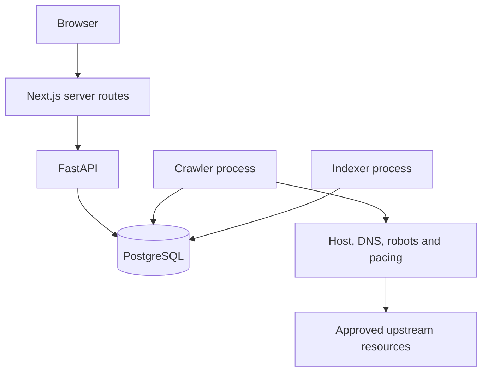
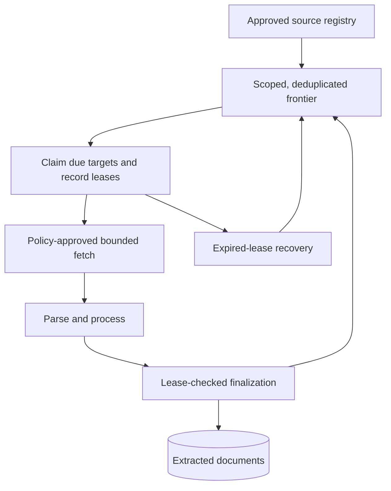
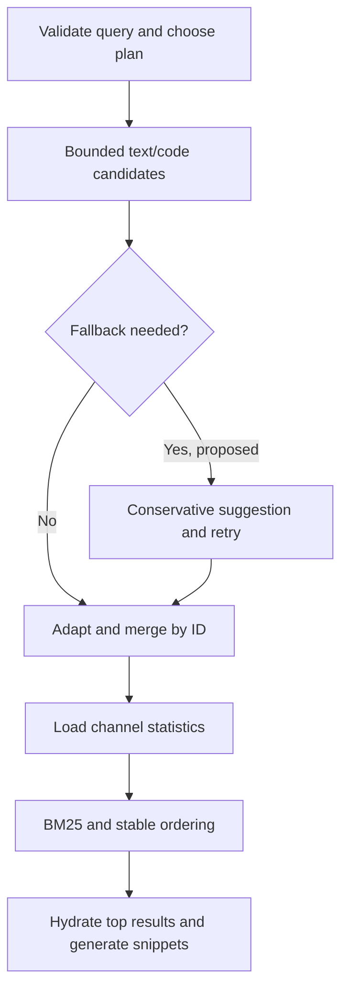

# Architecture and implementation snapshot

Reviewed on **2026-11-02** at [`facd333`](https://github.com/nishchup489-afk/developers_eye/commit/facd3336285f2da58b4f9c73efcd0d5ed6a05492). This is a source-level snapshot, not a production deployment verification. Paths below are relative to the repository root.

## Product and scope

Developer's Eye acquires developer content, normalizes it into local documents and serves lexical search over a PostgreSQL index. Documentation, issues, Q&A, articles, practice and events are product categories. A category in the UI is not evidence that its upstream platform is integrated or populated.

The original direction included hybrid API/crawl acquisition, a custom inverted index and later Redis/ARQ, distributed workers, Nginx and observability infrastructure. The implementation so far uses PostgreSQL for the frontier and search vectors. AI answers, embeddings, RAG and a separate B2B crawler are not implemented parts of this snapshot. Do not import claims from the separate `advanced_search_system` repository or its deployment.

## Process and trust boundaries

Backend owns models, migrations, public APIs and report query services. Crawler and indexer are packages in the crawler distribution and depend on the relative backend package. Backend never imports those worker packages. Next.js holds server configuration and admin credentials; the browser gets validated public results or session-authorized reports.

The declared Python baseline is >=3.14 and the frontend pins Next.js 16.3.8/React 19.2.8. The async PostgreSQL path uses SQLAlchemy and asyncpg; other declared dependencies are not proof of active runtime services. See [ADR-0013](ADR-0013-offline-online-process-boundaries.md) and [ADR-0012](../../backend/package-boundary/ADR-0012-crawler-depends-on-backend-never-reverse.md).

## Acquisition and durable state

The apparent cycle is intentional: successful completion schedules recrawl, discovery adds new targets, and failures defer/block/retry according to policy. Source rotation provides best-effort fairness; within a source, priority precedes depth. This is not strict global BFS. Target locks protect claims; per-source advisory locks protect frontier budget insertion. They must not be confused with the removed scheduler source-row lock or the global vocabulary mutex.

Network I/O is outside claim/finalization transactions. A retryable database finalization can be replayed without refetching. Exact lease ownership prevents a stale worker from replacing a newer claim. Attempts preserve their own lease so recovery accounts for the right owner. Parsing formats share the safety/writer lifecycle; sitemap records are discovery data, while feed/API entries can become documents.

## Storage ownership and consistency

| Durable relation | Meaning | Writer / consistency boundary |
| --- | --- | --- |
| source | Approved acquisition configuration and rotation timestamp | Insert-if-absent by slug; scheduler updates rotation metadata |
| crawl_target | URL identity, resource kind, priority, due time, state and lease | Frontier insertion; guarded scheduler transitions |
| crawl_attempt | One attempt, result/telemetry and its lease token | Worker and recovery; terminal measurements protected |
| crawl_event / crawl_worker | Pipeline observations and heartbeats | Crawler telemetry; read-only admin reports |
| robots_cache | Origin-specific robots response and expiry | Policy cache |
| document | Extracted content, metadata, fingerprint, revision and availability | Writer/finalization; raw HTML not retained |
| search_index | One document row, weighted text/code vectors, versioned hash/time | Index writer with document revision recheck |
| search_terms | Filtered combined-vector vocabulary and document counts | Transactional deltas and one-shot recount; current defects in INC-0007 |
| vocabulary_document_state model | Abandoned worker revision-tracking concept | No active writer; named migration is empty, so table existence is not established |

The intended index/vocabulary update boundary is one transaction. Normal upserts take the vocabulary advisory mutex before locking the source document, compare source ID/availability/updated_at, and then persist only that prepared revision. Deletions must use shared vocabulary-aware removal. The current missing mutex in the indexer removal entry point and repeated increment batch are **known violations**, not accepted desired behavior.

Document canonical URL uniqueness is global, whereas frontier URL uniqueness is per source. When sources write the same canonical URL, the most recent writer owns its source association; this is not a multi-source provenance model.

A PostgreSQL FK cascade can remove an index row without running application vocabulary deltas. Manual deletes and uncontrolled maintenance therefore require reconciliation and an approved repair procedure. After fixing incremental correctness, rebuild with workers stopped and verify counts before resuming. See [INC-0007](../../indexer/vocubulary/INC-0007-vocabulary-overcount-and-uncoordinated-removal.md).

## Index format and freshness

The selector derives work from missing/stale/old-version index state rather than a second queue. Builder/analyzer/vector stages are pure preparation; the writer owns transaction/session lifetime. Prepared SQL expressions do not imply that vectors were written successfully.

| Channel | PostgreSQL configuration | Weighted fields |
| --- | --- | --- |
| Text | english | title/tags A; headings/description B; body C |
| Code | simple | tags/title A; code_blocks/headings B; canonical_url D |

PostgreSQL owns tokenization and stemming. simple avoids English stemming but is not exact punctuation-preserving identifier storage. Field order, weights, configurations and hash payload belong to the versioned index format. Change them with INDEXER_INDEX_VERSION and a coordinated rebuild/report rollout. `reindex:pending` asks the normal worker to revisit a row without immediately deleting searchable data.

A content fingerprint represents normalized content; the versioned index hash also captures index-relevant inputs. Equal content_hash alone cannot establish vector freshness. Indexer selection is optimistic and can repeat work under concurrency; the writer rechecks the source revision. Repeatedly invalid documents currently lack durable failure backoff.

## Current public request

The actual route is:

1. Browser calls the same-origin Next.js `/api/search` bridge.
2. Without BACKEND_URL, the bridge returns labeled demo data. With it, the bridge calls FastAPI `/search`, validates payload shape, and surfaces live failures.
3. FastAPI locally normalizes q, opens a session and calls search_documents.
4. get_full_text_search searches both text and code vectors using websearch_to_tsquery and orders by summed ts_rank_cd. The service asks for up to 100 candidates.
5. The service loads available documents and ts_headline text in one additional SQL statement, maps categories/tags, applies the category filter and returns up to the requested limit.

The baseline service normally makes **two SQL statements when it has hits, one when it has none**, excluding session/transaction protocol traffic. That is separate from the BM25 statistics-loader count. Category filtering after the candidate cap can underfill a result page. No full match total or complete pagination engine exists.

## Modular search work and integration gaps

| Component | Source-level status | Gap before replacing the current path |
| --- | --- | --- |
| Analyzer | Implemented pure Unicode/length normalization | Public route still uses older normalization and 300-character bound |
| Planner | Implemented explicit all/text/code selection | No orchestration connected; current FTS is already dual-channel |
| FTS retrieval | Used by public service | Returns dictionaries, not RetrievalHit |
| Standalone code retrieval | Implemented component | Different query/rank normalization and CodeRetrievalHit adapter needed |
| Fuzzy correction | Partial, import-broken | Missing candidate function, self import, vocabulary drift and fallback policy |
| Merge/types | Implemented component | Adapt retriever results, then integrate |
| BM25 statistics/types | Implemented component | PostgreSQL validation, lexeme contract and corpus-refresh ownership |
| BM25 scorer/orchestrator | Empty files | Formula/edge cases/tests and orchestration still needed |
| New snippets | Implemented component; budget fix merged | Service still uses ts_headline; frontend span/Unicode contract needed |
| Pagination | Empty module | Define ordering, cursor/offset and total semantics |
| Cache/Nginx | Planned | No cache invalidation, deployment or proxy configuration implemented |

The intended orchestration, **not the current public request**, is:

Statistics callers must extract compatible positive lexemes, not pass a raw multi-term query or negation operators as one term. The query analyzer currently returns a string; it does not supply that ranking lexeme contract. Stored-position TF/DL are approximate and do not preserve the original field-weighted rank automatically. The scorer and snapshot consistency policy must address those limitations rather than hide them.

## Administrative and operational behavior

GitHub OAuth state/PKCE and the ADMIN_GITHUB_IDS allowlist establish an admin cookie; Next.js server routes attach the backend bearer key. The admin plane remains read-only. Crawler events/heartbeats support inspection, indexer reports expose coverage/freshness, and vocabulary views show stored count observations. Separate READ COMMITTED queries can observe different instants.

No working deployment, container stack, CI run, Nginx setup, global host limiter or cache is established by this snapshot. A root dependency on redis does not prove its use. Historical document-count reports are not capacity tests. The existing scheduler benchmark has a declared synthetic workload and limitations; use it within that scope only.

## What to read before a change

Start with the owning feature overview and its accepted ADRs/incidents, then inspect current code. [Record index](../../record-index.md) links every decision, incident and experiment. [Decision history](decision-history.md) explains the chronology; [optimization plan](../performance-and-scaling/optimization-plan.md) lists prerequisites and evaluation gates. The older technical_handoff.md is preserved as historical mechanics context and contains superseded status statements.
