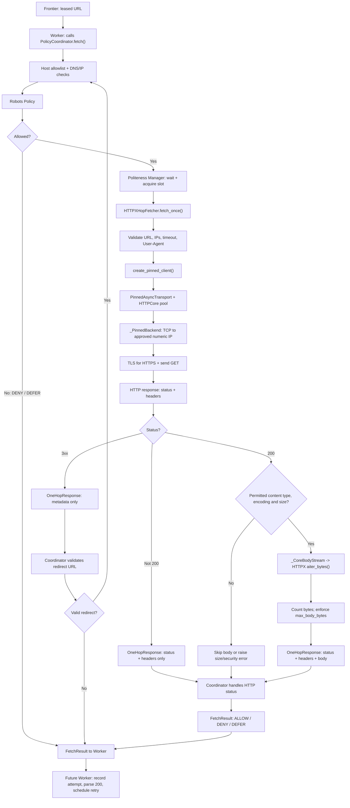
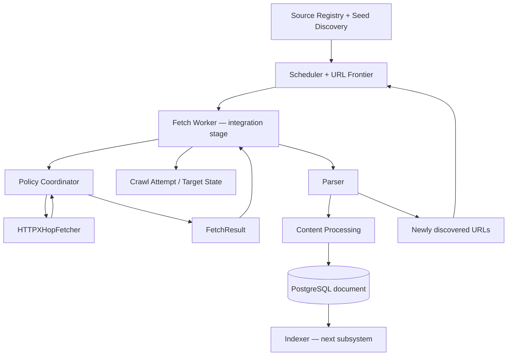

# Developer's Eye: Async Fetcher — Full Flow


---

---

## What are we building?

So this is one of the most important parts of our crawler. **FETCHER.**

Previously we made Source Registry, Seed Discovery, Scheduler, Frontier, and all our policies like Host Policy, DNS Policy, Robots Policy, Politeness Policy and Redirect Policy.

But none of those actually download the webpage for us. They mostly decide **which URL to fetch, whether it's safe, and when we are allowed to request it.**

That's where our Fetcher comes in.

**Our Fetcher makes exactly one authorized HTTP GET request, reads the response safely, and returns the result.** It does not parse HTML, discover links, save documents, or write a `crawl_attempt` record. Those will be jobs for the Worker and the later pipeline.

---

## 1. Full flow — from Frontier to the response



> The Worker boxes show the integration we are building next. They are **not** proof that the complete Worker is running yet.

Also, when `robots.txt` is missing or expired in the cache, the Coordinator can use the **same Fetcher** to download `robots.txt` first. Then it decides whether the actual page URL is allowed.

---

## 2. The shared schema between Policy Coordinator and Fetcher

For the Fetcher we made two things in `fetcher/schemas.py`:

- `OneHopFetcher` — a Python **Protocol**, basically a contract saying what a Fetcher must implement.
- `OneHopResponse` — a dataclass containing the result of **one** HTTP request.

```python
@dataclass(frozen=True, slots=True)
class OneHopResponse:
    status_code: int
    headers: Mapping[str, str]
    body: bytes = b""


class OneHopFetcher(Protocol):
    async def fetch_once(
        self,
        *,
        url: str,
        approved_ips: Sequence[str],
        max_body_bytes: int,
        timeout_seconds: float,
        user_agent: str,
    ) -> OneHopResponse: ...
```

### Why do we need this?

Imagine tomorrow we replace HTTPX with some other HTTP client. The Policy Coordinator should not need to know how that client works internally.

It only cares that the injected Fetcher has `fetch_once(...)` and returns a `OneHopResponse`.

**Important:** `OneHopFetcher` does **not** make a network connection by itself. It's a Python interface. `HTTPXHopFetcher` is the real implementation.

And `OneHopResponse` is **not** `FetchResult`:

| Object | Meaning |
|---|---|
| `OneHopResponse` | Result of a single HTTP GET: status, headers, optional body |
| `FetchResult` | Final Coordinator decision for a URL, potentially after multiple checked redirect hops |

---

## 3. Policy Coordinator — it controls the request, not the socket

The Policy Coordinator has a `fetch()` function. This checks the policies and returns a final `FetchResult` to its caller. But the Coordinator **does not open TCP connections itself**. It delegates each approved request to the Fetcher.

Inside its `_request_once()`:

```python
async def _request_once(
    self,
    url: str,
    approved_ips: Sequence[str],
    *,
    max_bytes: int,
) -> OneHopResponse:
    async with self.politeness.polite_slot(url):
        response = await self.fetcher.fetch_once(
            url=url,
            approved_ips=tuple(approved_ips),
            max_body_bytes=max_bytes,
            timeout_seconds=self.timeout_seconds,
            user_agent=self.user_agent,
        )
        # Coordinator also checks the returned body size and
        # records the response for politeness/backoff handling.
        return response
```

So basically:

1. Coordinator checks Host Policy and resolves safe IPs.
2. Coordinator checks Robots Policy.
3. Coordinator waits for a Politeness slot.
4. It calls the **real Fetcher's** `fetch_once()`.
5. The Fetcher returns a `OneHopResponse`.
6. The Coordinator checks redirects, backoff, errors, etc., and finally returns a `FetchResult`.

If a redirect occurs, the Coordinator doesn't blindly follow it. It validates the new URL and **runs Host, DNS, Robots and Politeness checks again** for the next hop.

---

## 4. `HTTPXHopFetcher` — where the actual HTTP request starts

File: `fetcher/fetch.py`

```python
class HTTPXHopFetcher:
    async def fetch_once(
        self,
        *,
        url: str,
        approved_ips: Sequence[str],
        max_body_bytes: int,
        timeout_seconds: float,
        user_agent: str,
    ) -> OneHopResponse:
        ...
```

This is the actual Fetcher. It receives all the approved information from the Coordinator.

**Before sending the request**, it validates the URL, approved IPs, timeout, body limit and User-Agent. It also sets headers including `Accept-Encoding: identity` to ask the server for an uncompressed response.

Then it creates an HTTPX client with **our own transport**, instead of relying on HTTPX's default network connection behavior.

```python
async with create_pinned_client(
    url=canonical_url,
    approved_ips=safe_ips,
    timeout_seconds=float(timeout_seconds),
) as client:
    async with client.stream(
        "GET", canonical_url, headers=headers
    ) as response:
        ...
```

That `client.stream("GET", ...)` triggers the real HTTP request.

`async with` is important here. It makes sure the response and client/transport are closed even when something fails.

The outer `asyncio.timeout(...)` in `fetch_once()` also limits the **whole operation**, not just one individual socket attempt.

---

## 5. `create_pinned_client()` — connect HTTPX to our transport

File: `fetcher/client.py`

Why do we need a separate client factory? Because we want every `fetch_once()` call to use a transport and connection pool scoped to that approved URL/IP set.

```python
transport = PinnedAsyncTransport(
    expected_url=httpx.URL(url),
    approved_ips=approved_ips,
)

client = httpx.AsyncClient(
    transport=transport,
    follow_redirects=False,
    trust_env=False,
    http2=False,
    timeout=httpx.Timeout(timeout_seconds),
    max_redirects=0,
)
```

Notice:

- **`follow_redirects=False`**: redirects must go back to the Coordinator for policy checks.
- **`trust_env=False`**: don't silently use proxy settings from the machine's environment.
- **One client/transport per call**: don't reuse an old TCP connection after DNS Policy has approved a potentially different set of IPs.

---

## 6. `PinnedAsyncTransport` — the bridge between HTTPX and HTTPCore

File: `fetcher/transport.py`

```python
class PinnedAsyncTransport(httpx.AsyncBaseTransport):
```

So HTTPX is our high-level HTTP client. HTTPCore handles lower-level HTTP connection management. `PinnedAsyncTransport` connects these two and plugs in our custom network backend.

### `__init__()`

When the transport is created, we:

1. Validate the expected HTTP/HTTPS URL.
2. Store its scheme, hostname and port.
3. Validate the approved numeric IPs.
4. Create `_PinnedBackend` using that host, port and IP list.
5. Create `httpcore.AsyncConnectionPool` using our `_PinnedBackend`.

We configure the pool with TLS verification, no proxy, no built-in connection retry, HTTP/1.1 and tight connection limits.

### `handle_async_request()`

This method is called by HTTPX when it sends a request.

```python
async def handle_async_request(
    self, request: httpx.Request
) -> httpx.Response:
    # Validate method / destination.
    # Convert HTTPX request into httpcore.Request.
    # Await the HTTPCore connection pool.
    # Wrap HTTPCore's body in _CoreBodyStream.
    # Return an HTTPX Response.
    ...
```

**It does not parse HTML or save documents.** It validates the outgoing request and passes it into HTTPCore.

### `aclose()`

```python
async def aclose(self) -> None:
    await self._pool.aclose()
```

This closes the HTTPCore connection pool.

---

## 7. `_PinnedBackend` — why we went this low-level

```python
class _PinnedBackend(httpcore.AsyncNetworkBackend):
```

This is our custom **TCP connection backend**.

### Why?

Imagine DNS Policy checks `docs.example.com` and approves a public IP. If the HTTP library resolves `docs.example.com` again later, it could receive a different IP, maybe a private one.

That's a **DNS rebinding / time-of-check-to-time-of-use** problem.

So our rule is simple:

**DNS Policy selects safe IPs. `_PinnedBackend` must connect only to those numeric IPs.**

```python
async def connect_tcp(self, host, port, timeout=None, ...):
    # Check host == expected host.
    # Check port == expected port.
    # Reject custom local_address.

    for numeric_ip in self._approved_ips:
        try:
            return await self._backend.connect_tcp(
                numeric_ip,
                port,
                timeout=timeout,
                local_address=None,
                socket_options=socket_options,
            )
        except (httpcore.ConnectError, httpcore.ConnectTimeout):
            # Try the next previously approved IP.
            ...

    # If all approved IPs failed, propagate the last error.
```

`self._backend` here is an instance of `httpcore.AnyIOBackend`. So **it's delegation, not recursion**. We're letting AnyIO perform the actual TCP connection, but we control the destination.

And we're not replacing the hostname with an IP everywhere. The original hostname is retained for the HTTP authority and HTTPS **TLS SNI/certificate verification**. The numeric IP is used for the socket connection.

Other methods:

- `connect_unix_socket()` rejects Unix sockets.
- `sleep()` delegates to the underlying backend.

**One small distinction:** trying the second approved IP after a TCP connection failure is not the same as retrying the HTTP GET. The Fetcher still makes at most one HTTP request per `fetch_once()`.

---

## 8. `_CoreBodyStream` — how response bytes come back

```python
class _CoreBodyStream(httpx.AsyncByteStream):
```

This is basically an **adapter** between HTTPCore's response stream and HTTPX's asynchronous byte-stream interface.

```python
async def __aiter__(self):
    async for chunk in self._stream:
        yield chunk
```

- `async for` waits for bytes from the underlying HTTPCore response stream.
- `yield` passes those bytes to HTTPX.
- `aclose()` closes the underlying stream.
- Supported HTTPCore errors should be translated into HTTPX errors.

**Important:** `_CoreBodyStream` does **not** decide the Fetcher's 16 KiB iteration chunk size. It's just carrying the byte stream. The Fetcher's `response.aiter_bytes(chunk_size=...)` is where our chosen iteration size is used.

---

## 9. Streaming: what happens when HTML is bigger than one chunk?

The Fetcher gets a response and checks:

1. Is the HTTP status `200`?
2. Is the `Content-Type` supported (HTML, JSON, XML, text, feeds, etc.)?
3. Did the server respect `Content-Encoding: identity`?
4. Is `Content-Length`, if present, within our `max_body_bytes` limit?

If allowed, it reads the body incrementally:

```python
body_chunks: list[bytes] = []
received = 0

async for chunk in response.aiter_bytes(
    chunk_size=self.config.chunk_size
):
    received += len(chunk)

    if received > max_body_bytes:
        raise ResponseTooLargeError(
            f"Response exceeds {max_body_bytes} bytes"
        )

    body_chunks.append(chunk)

return OneHopResponse(
    status,
    response_headers,
    b"".join(body_chunks),
)
```

Our current default `chunk_size` is **`16 * 1024` bytes = 16 KiB**, not 6 KB.

### Example

Imagine a permitted HTML response contains around 40 KiB of body data. HTTPX can yield multiple chunks during iteration (for example, 16 KiB + 16 KiB + 8 KiB). We keep counting the received bytes and stop if the configured limit is exceeded.

We are **not dividing the website into separate files**. We are reading one response body in chunks, then joining those bytes into one `body` in `OneHopResponse`.

The default maximum page body in the Coordinator is **2,000,000 bytes**, unless we configure it differently. The robots.txt body uses its own lower limit.

---

## 10. What happens with different HTTP responses?

| Situation | What the Fetcher returns / raises | What the Coordinator does |
|---|---|---|
| `200` + permitted text | `OneHopResponse(200, headers, body)` | Usually `ALLOW`; Worker can parse it |
| `200` + unsupported media type | `OneHopResponse(200, headers, b"")` | Currently `ALLOW` with empty body; Worker should skip parsing |
| `301`, `302`, `303`, `307`, `308` | Status and headers, no body | Validate `Location`, rerun policies, call Fetcher for next hop |
| `429` or `503` | Status and headers | `DEFER` with `Retry-After` or default backoff |
| Other `5xx` | Status and headers | `DEFER` |
| `304`, `404`, `410` | Status and headers, no body | Currently `ALLOW` with status metadata; Worker decides persistence/state |
| Oversized body | `ResponseTooLargeError` | Intended `DENY` |
| Unsafe transport / bad encoding | `FetcherSecurityError` | Intended `DENY` |
| Timeout / network failure | Raises an error | Usually `DEFER` |

Notice: **`ALLOW` does not necessarily mean HTTP 200** in the Coordinator's current code. It means the request was permitted and a non-deferred response outcome was reached.

And the Fetcher doesn't automatically follow redirects. Every redirect is handled by the Coordinator as a **new checked hop**.

---

## 11. Three real scenarios

### Scenario A — One normal HTML page

Imagine the Worker eventually claims an approved documentation URL.

1. Coordinator checks Host, DNS and Robots policies.
2. Politeness Manager grants permission to start the request.
3. Fetcher creates an HTTPX client with our pinned transport.
4. `_PinnedBackend` connects to one of the approved IPs.
5. HTTPS verifies the original hostname.
6. Server sends `200 OK` and HTML.
7. `_CoreBodyStream` carries response bytes into HTTPX.
8. Fetcher reads chunks, counts bytes and joins the body.
9. Fetcher returns `OneHopResponse`.
10. Coordinator returns `FetchResult(ALLOW, ...)`.
11. **Future Worker** sends `result.body` to Parser and records the crawl outcome.

### Scenario B — Website redirects us

Imagine the approved page responds with `302 Location: /new-docs`.

1. Fetcher returns **302 metadata**, without following the redirect.
2. Coordinator reads the `Location` header.
3. `RedirectTracker` validates and normalizes the next URL.
4. Coordinator checks Host, DNS, Robots and Politeness again.
5. Then it calls `fetch_once()` for the new URL.

This matters because a harmless-looking URL could otherwise redirect us to a private IP or an unapproved host.

### Scenario C — Server responds `429 Too Many Requests`

1. Fetcher returns status and headers without reading the body.
2. Coordinator reads `Retry-After`, or uses its default backoff.
3. Coordinator returns `FetchResult(DEFER, retry_after_seconds=...)`.
4. **Future Worker/Scheduler** will record the attempt and reschedule it later.

No Parser. No document saved from that response.

---

## 12. What still needs fixing in our current code?

Our architecture makes sense, but **implemented doesn't mean fully integration-tested**. Before the Worker uses this on arbitrary external URLs, these need attention:

1. **Shared exception classes:** `PolicyCoordinator` currently defines its own `ResponseTooLargeError` and `FetcherSecurityError`. It needs to import the actual classes from `crawler.fetcher.errors`, otherwise its catches won't match Fetcher's exceptions.
2. **Fetcher protocol import path:** The Coordinator currently imports from `crawler.src.crawler.fetcher.schemas`; given our package layout the intended path is `crawler.fetcher.schemas`.
3. **HTTPCore exception handling:** Our transport currently catches `httpcore.HTTPError`, but that name isn't exported by the installed HTTPCore 1.0.x version. Catch the supported HTTPCore exception families instead.
4. **Transport request validation:** The current transport checks scheme/hostname/port, but should also enforce the complete approved URL (including path/query) and reject dangerous custom `Host` and TLS SNI overrides.
5. **End-to-end verification:** We still need to prove that Coordinator + Fetcher + a real Worker can crawl, handle failures and save results correctly.

Don't confuse these fixes with the features the Worker will add. The Fetcher itself is **not** supposed to write to `crawl_attempt` or `document`.

---

## 13. Where this fits into the full offline engine



So far we've been building the individual modules. Our next move is a **thin Worker** that connects what we already have, so I can actually see the crawler work instead of writing module after module without observing the result.

**The goal is not just to see tests pass. The goal is to start the Worker, crawl approved URLs, see real documents in PostgreSQL, and then build the Indexer on top of them.**

---

### Source code

Repository: https://github.com/nishchup489-afk/developers_eye

Relevant files:

- `crawler/src/crawler/fetcher/schemas.py`
- `crawler/src/crawler/fetcher/fetch.py`
- `crawler/src/crawler/fetcher/config.py`
- `crawler/src/crawler/fetcher/client.py`
- `crawler/src/crawler/fetcher/transport.py`
- `crawler/src/crawler/policy_and_politeness/policy_coordinator.py`
