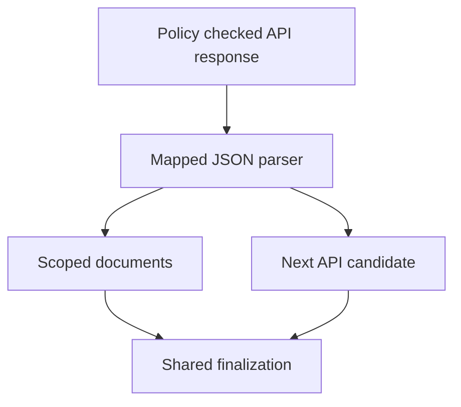

# JSON API Ingestion

**Files:** `parser/api/json_parser.py`, `parser/structured.py`, `seed/discovery.py`, `worker/jobs/jobs.py`.

## 1. Before we start, why can't we just parse JSON?

So the crawler can already download response bytes. Calling `json.loads()` gives us Python dictionaries and lists. But it does not tell us which field is the page URL, where the article body lives, or which field points to the next page.

An API might call its URL `html_url`. Another calls it `link`. One puts entries inside `data.results`, while another returns a plain array.

We solve that with a small mapping in each source's configuration. The parser still returns our existing `ParsedDocument` and `ParseResult` objects.

## 2. Start with the simplest response

```json
[
  {
    "url": "https://example.com/docs/async",
    "title": "Python async guide",
    "body": "Use Python tasks to run concurrent operations.",
    "description": "An introduction to asyncio.",
    "author": "Nish",
    "published_at": "2026-10-20T10:00:00Z"
  }
]
```

Those are the default field names. The parser accepts a root array, a single root document object, or a root object containing an `items` collection.

A valid empty array means the API currently has no entries. A configured collection path that does not exist is an error, because pretending it is an empty result would hide a broken mapping.

## 3. Now give the API a different shape

```json
{
  "data": {
    "results": [
      {
        "html_url": "/docs/async",
        "name": "Python async guide",
        "content": "<p>Use Python tasks for concurrent operations.</p>",
        "user": {"login": "Nish"}
      }
    ]
  },
  "paging": {"next": "?page=2"}
}
```

The corresponding source can be:

```json
{
  "slug": "example-api",
  "name": "Example documentation API",
  "kind": "api",
  "base_url": "https://example.com/api/articles",
  "allowed_hosts": ["example.com"],
  "crawl_interval_seconds": 3600,
  "config": {
    "allowed_path_prefixes": ["/docs"],
    "max_depth": 3,
    "max_pages": 10000,
    "follow_entry_links": false,
    "api": {
      "items_path": "data.results",
      "next_path": "paging.next",
      "body_format": "html",
      "fields": {
        "url": "html_url",
        "title": "name",
        "body": "content",
        "author": "user.login"
      }
    }
  }
}
```

Add this definition to a JSON array under `seed/sources`. Startup sync registers new slugs and discovery queues an `api` target. Updating a source that already exists requires a registry update; startup insertion deliberately does not overwrite existing rows.

## 4. What do those paths mean?

`items_path` starts at the complete response. `data.results` means read the `data` object, then its `results` value.

Each field mapping starts at one individual record. `user.login` reads that record's author name. Unspecified mappings retain the default field names.

`next_path` starts at the complete response again. `paging.next` points to the next collection endpoint.

A numeric segment can select a list element, for example `groups.0.items`. An empty `items_path` selects the whole response. There is no expression evaluation, wildcard search or automatic provider-specific schema guessing. Unknown options and invalid field paths are rejected.

## 5. Build a document, not a JSON dump

Each record needs a usable HTTP(S) URL. Relative links resolve against the fetched API URL. Credentials, unsafe schemes, malformed ports and invalid URL characters are rejected.

Only string values populate text fields. Objects and arrays do not become searchable Python dictionary representations. A missing or non-string body becomes empty content, which the shared processor can skip with its normal reason.

`body_format: "text"` preserves plain text. `"html"` strips markup from body and description and removes script/style content. The parser does not assume Markdown is rendered HTML.

Dates use the same UTC conversion as feeds. Metadata records `ingestion_format: "json_api"` and the fetched `api_url`, so the dashboard inspector can show where a stored document came from.

## 6. Keep the content inside its source

The collection endpoint may be `/api/articles`, while stored page URLs must fall under `/docs`. Those are separate roles.

API sources do not automatically expand into sitemaps unless `discover_sitemaps: true` is explicitly configured.

Before processing and storage, the worker filters every imported document by `allowed_hosts` and the configured content paths. A response from an approved API cannot insert a document pointing at an unrelated host.

Duplicate record URLs retain their first record in a response. Across attempts, the existing canonical URL upsert and content fingerprint handle repeated observations.

## 7. Pagination stays in the frontier

A usable `next_path` URL becomes another `api` target. It is not fetched inside the JSON parser.



The next target goes through host/DNS safety, robots, checked redirects, politeness, leases and retries. Source budgets, normalized-URL uniqueness and depth bound pagination loops. `max_depth: 3` permits the root endpoint plus three further pagination levels.

Only configured JSON-body pagination is supported. This implementation does not infer page numbers, parse HTTP Link-header pagination or add provider-specific authentication. It is a GET ingestion path for public JSON endpoints. A provider that needs a special adapter still needs that adapter.

## 8. Limits and failed responses

A parser response is limited to 2,000,000 bytes and 1,000 records, counted before invalid records are skipped. UTF-8 JSON with an optional BOM is accepted. Invalid syntax, duplicate object keys, non-finite numbers and excessively nested input are rejected.

The worker records parser failures and uses its existing retry schedule. It respects HTTP rate-limit responses and Retry-After through the shared fetch policy. `X-Robots-Tag: noindex` prevents storing imported records; `nofollow` prevents article and pagination enqueueing.

`follow_entry_links` defaults to false. Set it to true to additionally queue the records' HTML pages. The stored API text can be a summary; the crawler does not claim it downloaded a full article just because a record has a page URL.

## 9. Verify the mapping before a live crawl

From the repository root:

```powershell
.\crawler\.venv\Scripts\python.exe -m pytest crawler/tests/test_json_api.py crawler/tests/test_ingestion_jobs.py -q
```

Parser tests cover root shapes, nested fields, HTML bodies, duplicate URLs, invalid mappings and input limits. Worker tests run the actual parser and content processor with mocked network/finalization, checking scope filtering, pagination and noindex behavior.
