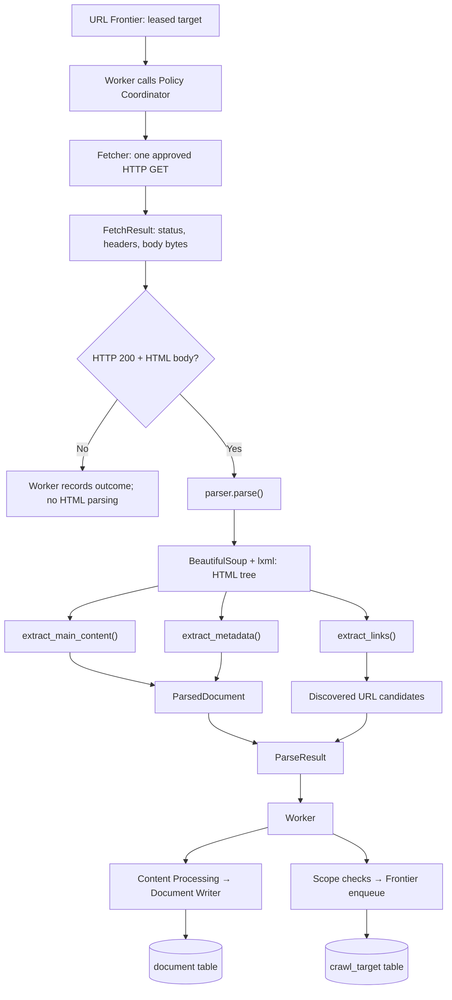

# Developer's Eye: Parser Engine

---


---

## What is the Parser?

So far we built the Source Registry, Seed Discovery, Scheduler, Frontier, Policy Coordinator and Fetcher.

The Fetcher can download the response from a website. BUT that response is still just bytes. We can't put an entire HTML page full of navigation bars, scripts, buttons, ads and random things into our search engine and expect good search results.

That's where our **Parser** comes in.

The Parser receives the already-fetched response, reads the HTML and extracts the useful information. It doesn't crawl another URL, doesn't make HTTP requests, doesn't check robots.txt and doesn't write anything to PostgreSQL.

**Fetcher gets the webpage. Parser understands what's inside that webpage.**

For now we are focusing on **HTML**. We have folders for JSON APIs and RSS/Atom feeds, but their parser implementations are still empty.

## Complete flow



**Important:** The Worker will connect these stages. This flow is the integration we are building, not a claim that the complete Worker is already running.

## Our Parser folder

```text
crawler/src/crawler/parser/
│
├── __init__.py
├── parser.py               # Main entry point: parse()
├── schemas.py              # ParsedDocument, ParseResult, DiscoveredLink
├── errors.py               # Parser-related exceptions
│
├── html/
│   ├── __init__.py
│   ├── extractor.py        # Main readable content
│   ├── metadata.py         # Title, description, author, dates, etc.
│   └── links.py            # Discover more links
│
├── api/
│   └── json_parser.py      # Placeholder for later
│
└── feeds/
    └── rss_atom.py         # Placeholder for later
```

We divided it into smaller modules instead of stuffing everything into one huge `parser.py`.

Why? Because extracting body text, reading metadata and finding links are three different jobs. The main `parse()` function just connects them.

---

## 1. `parser.py` — Our entry point

Our function:

```python
def parse(*, url: str, content: bytes, content_type: str | None) -> ParseResult:
    ...
```

It accepts:

- `url`: the **final fetched URL**, not necessarily the original URL before redirects.
- `content`: response body bytes from `FetchResult.body`.
- `content_type`: the HTTP `Content-Type` header, such as `text/html; charset=utf-8`.

First, it checks the URL and content type. The HTML parser currently supports `text/html` and `application/xhtml+xml`.

Then:

```python
soup = BeautifulSoup(content, "lxml", from_encoding=charset)
```

**BeautifulSoup** helps us navigate and search the HTML tree. **lxml** is the underlying HTML parsing engine used to build that tree. We aren't using BeautifulSoup to make HTTP requests.

Imagine the response contains:

```html
<html>
  <head>
    <title>Python Asyncio Documentation</title>
    <meta name="description" content="Learn Python asyncio">
  </head>
  <body>
    <nav>Home | About | Contact</nav>
    <main>
      <h1>Asyncio</h1>
      <p>Asyncio is a library for writing concurrent code.</p>
      <a href="../library/os.html">OS module</a>
      <pre>async def main():
    print("Hello")</pre>
    </main>
  </body>
</html>
```

BeautifulSoup turns it into a tree. Now our other modules can inspect that tree.

After building the soup, `parse()` calls:

```python
extracted = extract_main_content(soup)
metadata = extract_metadata(soup, page_url=url)
links = extract_links(soup, page_url=url)
```

And finally combines everything into `ParsedDocument` and `ParseResult`.

---

## 2. `html/extractor.py` — Extract the actual readable content

This was one of the more interesting parts.

Imagine opening an MDN or Python documentation page. There might be a navbar, footer, cookie popup, sidebar, table of contents, buttons and lots of other HTML.

We need the **actual documentation**, not all that extra stuff.

### `_REMOVE_TAGS`

Contains HTML tags we don't want in our main text, like:

```python
_REMOVE_TAGS = frozenset({"head", "script", "style", "nav", "footer", "aside", ...})
```

`frozenset` is basically a set we don't intend to modify.

### `_NOISE_MARKERS` and `_is_noise()`

Not every website uses `<nav>` for navigation. Sometimes it's just:

```html
<div class="sidebar">Related links</div>
<div class="cookie-banner">Accept cookies</div>
```

So `_is_noise()` checks the tag name, CSS classes, ID, role, hidden attributes and some inline styles to determine whether an element looks like unwanted content.

This is **heuristic filtering**, not a guarantee. Websites can use completely different class names.

### `deepcopy()`

```python
working = deepcopy(candidate)
```

Why copy the HTML?

Because we use `.decompose()` to remove unnecessary tags. Without a copy, we'd be deleting tags from the original soup, and then `links.py` or `metadata.py` might lose information they still need.

### `_TextCollector`

This class walks through the cleaned tree and collects three things:

```python
@dataclass(frozen=True, slots=True)
class ExtractedContent:
    body: str
    headings: tuple[str, ...]
    code_blocks: tuple[str, ...]
```

Its `walk()` method is **recursive**: it visits a tag, visits its children, and keeps going until it reaches the text.

`_BLOCK_TAGS` helps keep paragraphs and headings on separate lines. The `_line_break()` method combines text fragments into readable lines.

A developer-focused search engine also needs code examples. So when it encounters `<pre>`, it stores the block separately and preserves its indentation.

**Example output:**

```python
ExtractedContent(
    body="Asyncio\nAsyncio is a library for writing concurrent code.\nasync def main():\n    print(\"Hello\")",
    headings=("Asyncio",),
    code_blocks=('async def main():\n    print("Hello")',),
)
```

The body includes readable prose and code; `code_blocks` additionally records the preformatted code separately.

---

## 3. `html/metadata.py` — Get details about the document

The body isn't enough for a search engine.

When a user searches for something, we want a result title, description, URL, author if available and other useful information.

That's what `extract_metadata()` does.

It looks for information such as:

- Page title: `og:title`, `twitter:title`, `<title>`, or `<h1>` (in that order).
- Description: `meta description`, Open Graph or Twitter description.
- Author: available author metadata.
- Publication time: supported date metadata, normalized to UTC when a timezone is known.
- Canonical URL hint: `rel="canonical"` or `og:url`.
- Extra metadata: language, site name, keywords, image URL hint, section, tags and robots directives.

For example:

```html
<title>Python Asyncio</title>
<meta name="description" content="Learn asynchronous Python">
<link rel="canonical" href="/3/library/asyncio.html">
```

Our metadata extractor returns an `ExtractedMetadata` object.

**Why do we call it `canonical_url_hint` and not automatically trust it?**

Because a webpage can claim that its canonical URL is almost anything. The Parser only extracts that suggestion. Content Processing / persistence must validate the canonical URL before using it as the database identity. It is NOT permission to crawl another host.

Same thing for `image_url_hint`.

---

## 4. `html/links.py` — Discover more URLs

The crawler can't grow if it only visits the original seed URLs.

Imagine we fetched:

`https://docs.python.org/3/tutorial/`

Inside the page:

```html
<a href="../library/asyncio.html">Asyncio</a>
<a href="../library/os.html">OS</a>
<a href="#examples">Examples</a>
<a href="mailto:someone@example.com">Email</a>
```

The Parser finds the `href` attributes and uses `urljoin()` to resolve relative links against the page URL (or a valid HTML `<base href>`).

Then it calls our existing `frontier.urls.normalize_url()` to normalize URLs and remove fragments.

It skips invalid links, unsupported schemes, empty/fragment-only links, duplicate URLs and `rel="nofollow"` links.

```python
links = extract_links(soup, page_url=url)
```

Example URL candidates:

```text
https://docs.python.org/3/library/asyncio.html
https://docs.python.org/3/library/os.html
```

**Where do those URLs go?**

NOT `source` table.

NOT `crawl_attempt` table.

They are candidates for the **`crawl_target` table**, via our Frontier's existing `enqueue_targets()` function.

However, the Parser should NOT insert them directly. The Worker must enforce source discovery scope and `allowed_hosts`, then enqueue only eligible targets. When a target is actually fetched, its attempt is recorded in `crawl_attempt`.

The Parser currently filters per-link `rel="nofollow"`. Page-wide robots meta directives can be extracted by `metadata.py`, but the Worker still needs to enforce relevant directives before following links.

---

## 5. `schemas.py` — What the Parser returns

We have three important structures.

### `ParsedDocument`

This represents **one extracted document**, before Content Processing.

Fields include URL, title, description, body, author, headings, code blocks, publication time, metadata and canonical URL hint.

### `ParseResult`

This represents the **overall parsing result for one fetched response**.

```python
@dataclass(slots=True)
class ParseResult:
    source_url: str
    content_type: str
    documents: tuple[ParsedDocument, ...] = ()
    discovered_links: tuple[DiscoveredLink, ...] = ()
```

Why both `ParsedDocument` and `ParseResult`?

Because one fetched resource could eventually contain multiple documents. For now HTML produces one `ParsedDocument`. Later API/feed parsers might produce many.

### `DiscoveredLink`

The schema also defines a richer link type with URL, anchor text, `rel`, and a `nofollow` flag. **Our current HTML extractor returns plain URL strings, so we still need to align these two interfaces** before relying on the typed `ParseResult` contract.

---

## 6. Complete real-world scenario

Suppose our Worker claims a target:

`https://docs.python.org/3/tutorial/`

**STEP 1:** The Policy Coordinator checks Host, DNS, Robots, Politeness and redirects, using the Fetcher for actual HTTP requests.

**STEP 2:** The Fetcher returns the response body bytes. The Coordinator produces a final `FetchResult`.

**STEP 3:** The Worker sees `ALLOW`, HTTP `200`, a supported HTML content type and a nonempty body. It passes `final_url`, `body` and `Content-Type` to `parser.parse()`.

**STEP 4:** BeautifulSoup + lxml construct the tree. We call our three HTML helpers on the original soup.

**STEP 5:** `extractor.py` collects main text, headings and code blocks. `metadata.py` collects title, description, canonical hint and more. `links.py` discovers normalized URL candidates.

**STEP 6:** `parser.py` returns a `ParseResult`.

**STEP 7:** The future Worker passes `ParsedDocument` into the Content Processing pipeline (normalize, classify, fingerprint, deduplicate), then the Document Writer persists it.

**STEP 8:** The Worker checks discovered links against source scope and gives eligible URLs to the Frontier. The Scheduler can eventually claim those targets too.

That's how we move from **one downloaded page** to **a crawler that continuously discovers more pages**.

```text
Fetcher
  ↓ raw response bytes
Parser
  ├── readable body + headings + code
  ├── metadata
  └── discovered links
  ↓ ParseResult
Worker
  ├── Content Processing → document table
  ├── Frontier → crawl_target table
  └── Attempt handling → crawl_attempt table
```

---

## 7. What the Parser DOES NOT do

- It doesn't establish TCP connections or download pages. Fetcher does that.
- It doesn't approve hosts, IPs, robots rules or redirects. Policy Coordinator handles that.
- It doesn't decide which URLs get crawled next. Worker + Frontier + Scheduler handle that.
- It doesn't save `crawl_attempt` or `document`. The Worker / database repositories handle persistence.
- It doesn't do document classification or content hashing. Content Processing handles that.
- It doesn't build `TSVECTOR` or GIN indexes. Indexer handles that.

**The Parser's job is extraction, not orchestration.**

---

## 8. Fix before connecting the Worker

Two small integration mismatches in the current repository:

**A. Incorrect export in `html/__init__.py`.**

The file imports `find_links`, but `links.py` defines `extract_links`. Replace the import and `__all__` entry with `extract_links`. Otherwise importing the HTML package can fail before `parser.parse()` even runs.

```python
from .links import extract_links
```

**B. `discovered_links` type mismatch.**

`links.py` currently returns `tuple[str, ...]`, but `ParseResult.discovered_links` is declared as `tuple[DiscoveredLink, ...]`. Pick one contract and update the code accordingly. For our first HTML-only MVP, either use URL strings everywhere or convert them into `DiscoveredLink` objects.

Also test malformed HTML, empty bodies, non-HTML content types, invalid relative links, unexpected encodings and canonical hints pointing to another host.

JSON and RSS/Atom parser implementations are **not written yet**; don't claim we support them just because their folders exist.

---

## Final summary

So the Parser basically receives the HTML from the Fetcher and turns it into useful, structured data.

`parser.py` is the entry point.

`extractor.py` extracts the actual content.

`metadata.py` extracts details about the document.

`links.py` finds more pages we might want to crawl.

`schemas.py` defines the result these functions return.

And the Worker will connect the Parser with Content Processing, database writers and the URL Frontier.

**FETCHER DOWNLOADS IT → PARSER EXTRACTS IT → PROCESSING CLEANS IT → INDEXER MAKES IT SEARCHABLE.**

**Next: Content Processing + our first running Worker.**
