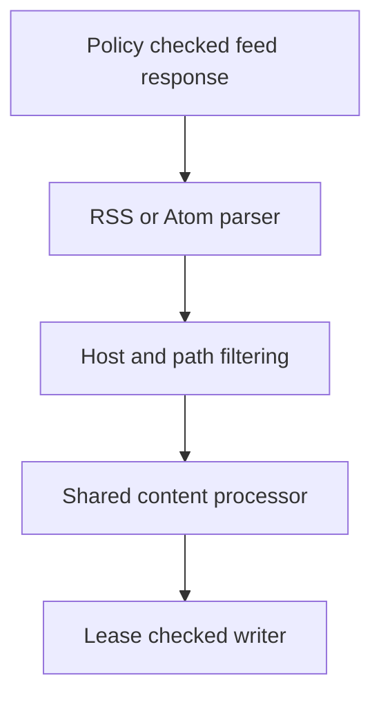

# RSS and Atom Feed Ingestion

**Files:** `parser/feeds/parser.py`, `parser/structured.py`, `seed/discovery.py`, `worker/jobs/jobs.py`.

## 1. Before we start, why do we need feeds?

So our crawler can read HTML and discover pages from sitemaps. A feed gives us something different: a collection of already-published entries, often with a title, author, date and article text.

Suppose a Python blog publishes a feed every time it adds a tutorial. We can process those entries directly instead of treating the feed URL as one HTML document.

One downloaded feed can produce several `ParsedDocument` objects. The feed itself is not the document identity; each entry's page URL is.

## 2. Two formats, one output

An RSS 2.0 feed looks like this:

```xml
<rss version="2.0">
  <channel>
    <item>
      <title>Python async guide</title>
      <link>https://example.com/docs/async</link>
      <description>Learn how Python tasks run concurrently.</description>
      <pubDate>Tue, 20 Oct 2026 10:00:00 +0000</pubDate>
    </item>
  </channel>
</rss>
```

Atom 1.0 uses `feed`, `entry` and a different link shape:

```xml
<feed xmlns="http://www.w3.org/2005/Atom">
  <entry>
    <title>Python async guide</title>
    <link href="https://example.com/docs/async"/>
    <content type="text">Learn how Python tasks run concurrently.</content>
    <updated>2026-10-20T10:00:00Z</updated>
  </entry>
</feed>
```

Both become the same `ParseResult` structure, so the normalizer, classifier, fingerprinting and database writer can stay shared.

## 3. Register the source correctly

A feed source uses `kind: "rss"`, including Atom feeds:

```json
{
  "slug": "example-python-feed",
  "name": "Example Python feed",
  "kind": "rss",
  "base_url": "https://example.com/feed.xml",
  "allowed_hosts": ["example.com"],
  "crawl_interval_seconds": 3600,
  "config": {
    "allowed_path_prefixes": ["/docs"],
    "max_depth": 3,
    "max_pages": 10000,
    "follow_entry_links": false
  }
}
```

Add the definition to a JSON array under `seed/sources`. The worker's startup registration inserts new slugs and discovery queues the feed endpoint. Existing source configuration is preserved; changing an already-registered slug's JSON does not overwrite its database row.

The endpoint can be outside `/docs`. Imported entry URLs must still be on an allowed host and inside the configured content paths.

Feed sources do not automatically expand into a site's sitemaps. Set `discover_sitemaps: true` explicitly if that wider discovery is wanted.

## 4. How do we choose the entry URL?

For RSS, prefer `<link>`. A `<guid>` can be used only when it is an absolute HTTP(S) permalink and `isPermaLink` is not false.

For Atom, prefer an alternate HTML link. An absolute HTTP(S) `<id>` is a fallback. An opaque `urn:uuid:...` is an identity, not a webpage URL, so it cannot become a stored document URL.

Relative links resolve against the feed URL and inherited `xml:base`. Invalid URLs are skipped, and duplicate entry URLs retain the first record.

## 5. Extract content without fetching it again

RSS prefers `content:encoded`, falling back to `description`. Atom prefers inline `content`, falling back to `summary`. External Atom content is not fetched automatically.

HTML fragments become readable text. Script and style content is removed. Atom plain-text content remains plain text, so `Use <button>` does not lose the literal tag name.

RSS authors come from `author` or `dc:creator`. Atom uses the entry author or the feed's author. Published dates accept ISO timestamps and RSS-style mail dates. Dates are converted to UTC; timezone-free dates are interpreted as UTC. An invalid date becomes `None` instead of discarding an otherwise valid entry.

## 6. What does `follow_entry_links` do?

The default is false. We store the content actually supplied by the feed, and do not automatically queue every article for a second HTML fetch.

Set it to true when the feed contains short summaries and you also want the full pages crawled. Those page requests go through the normal policies and link-depth budget. Imported feed content can still be only a summary; we do not label it as a full article.

## 7. Pagination is another frontier job

Atom `link rel="next"` is followed as another `rss` target. RSS can supply the equivalent `atom:link` extension.

We enqueue the next endpoint instead of fetching it recursively inside the parser. The same source budget, normalized-URL deduplication, max depth, leases and retry behavior apply. With `max_depth: 3`, the root feed and up to three subsequent link levels are eligible.

A response is bounded to 2,000,000 bytes and 1,000 entries. Too many entries or unsafe XML fails the parse. Limits count all entries, including ones that later have invalid URLs. RSS 1.0/RDF and arbitrary XML formats are not implemented by this parser.

## 8. Where the existing pipeline takes over



The writer stores each accepted entry with its own canonical URL. Its metadata records `ingestion_format` and `feed_url`, which are visible through document inspection. Existing fingerprints and upserts handle repeated feed observations.

An HTTP `X-Robots-Tag: noindex` applies to all imported entries. `nofollow` stops article and pagination enqueueing. A malformed feed becomes a failed attempt with the usual retry schedule and dashboard error details.

## 9. Verify without a live crawl

From the repository root:

```powershell
.\crawler\.venv\Scripts\python.exe -m pytest crawler/tests/test_feeds.py crawler/tests/test_ingestion_jobs.py -q
```

The parser tests use literal XML. Worker tests run the real parser and processor while replacing network and finalization with test doubles. They verify scope filtering, pagination, HTTP directives and malformed-feed retry behavior. They do not claim to test a live website or PostgreSQL transaction.
