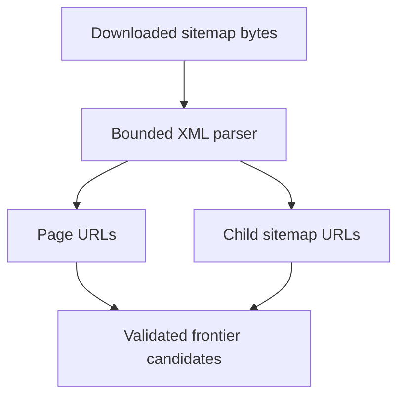

# XML Sitemap Parser

**File:** `crawler/src/crawler/parser/sitemap.py`

## 1. Before we start, what are we building?

So our crawler already knows how to download an HTML page and follow its links. But suppose a documentation website has 10,000 pages. Starting at the homepage does not guarantee that every page is linked somewhere we can reach.

The website can publish a sitemap. Think of it as a list of URLs the website gives to crawlers.

Our parser takes already-downloaded XML and returns those URLs. It does not open a connection or write anything to PostgreSQL.

## 2. Two files that look similar but mean different things

A regular sitemap contains page URLs:

```xml
<urlset xmlns="http://www.sitemaps.org/schemas/sitemap/0.9">
    <url><loc>https://example.com/docs/python</loc></url>
    <url><loc>https://example.com/docs/javascript</loc></url>
</urlset>
```

A sitemap index contains URLs of other sitemap files:

```xml
<sitemapindex xmlns="http://www.sitemaps.org/schemas/sitemap/0.9">
    <sitemap><loc>https://example.com/python-sitemap.xml</loc></sitemap>
</sitemapindex>
```

Why keep these separate? If we treated the second URL as an HTML page, we would hand XML to our HTML parser.

## 3. What comes back?

```python
@dataclass(frozen=True, slots=True)
class SitemapResult:
    page_urls: tuple[str, ...] = ()
    sitemap_urls: tuple[str, ...] = ()
```

`page_urls` contains actual pages. `sitemap_urls` contains more maps to read. Only one of these tuples is populated for a given file.

`frozen=True` prevents field reassignment. `slots=True` avoids an instance dictionary. Neither changes what the URLs mean.

## 4. First, put limits around the input

```python
MAX_XML_BYTES = 10 * 1024 * 1024
MAX_ENTRIES = 50_000
```

We reject empty files and files larger than 10 MiB. We count every sitemap entry, including invalid and duplicate entries. Otherwise a file containing 100,000 copies of one URL could bypass a limit based only on unique URLs.

Exactly 50,000 entries are allowed. Entry 50,001 fails the whole parse, so we do not return a misleading partial result.

These parser limits do not override the worker's HTTP body limit. A response may be rejected by the fetcher before it reaches this function.

## 5. What about `.xml.gz`?

Some websites compress the sitemap file itself with gzip. The parser recognizes gzip's first two bytes and reads at most `MAX_XML_BYTES + 1` decompressed bytes.

Why the extra byte? If it exists, we know the decompressed XML exceeds our limit. We reject it without expanding the rest of the file.

HTTP `Content-Encoding: gzip` is rejected by the fetcher's identity-encoding policy. A downloaded `.xml.gz` file with identity HTTP encoding is a separate case handled here. Sitemap jobs explicitly allow gzip file MIME types; regular HTML jobs keep their existing textual MIME allowlist.

## 6. Parse XML without trusting it

```python
root = fromstring(content, forbid_dtd=True)
```

`fromstring` comes from `defusedxml`. DTDs and XML entities are rejected. A sitemap cannot ask our parser to read a local file or expand attacker-controlled entities.

Malformed XML, unsafe XML and broken gzip data become `MalformedContentError`. Passing a string instead of bytes raises `TypeError`, because that is a caller mistake.

## 7. Namespaces matter

For a namespaced sitemap, XML gives us a tag like:

```text
{http://www.sitemaps.org/schemas/sitemap/0.9}urlset
```

We accept the standard sitemap namespace and the common namespace-free form. We read `url`, `sitemap` and `loc` in the same namespace as the root.

Suppose an image extension contains `<image:loc>`. That is an image URL, not the page's `<loc>`. Matching only the word `loc` would mix them up.

## 8. Extract URLs, then let the crawler authorize them

Each direct sitemap entry supplies its direct `<loc>` child. Missing locations are skipped. We reject relative URLs, credentials, invalid ports, whitespace, control characters and non-HTTP schemes.

A dictionary removes identical duplicates while preserving first-seen order. URL strings remain unnormalized here. Frontier creation performs canonical URL normalization and host/scope validation.

An extracted URL is a candidate. It still needs allowed-host, DNS/IP, redirect, robots and politeness checks before any request.

## 9. Try it without running the crawler

From the repository root:

```powershell
.\crawler\.venv\Scripts\python.exe -m pytest crawler/tests/test_sitemap.py -q
```

These tests use XML bytes in memory. They do not crawl a website or connect to PostgreSQL.

## 10. Where this fits



The next part is discovery: where the first sitemap URL comes from, how child sitemaps enter the frontier, and how the worker dispatches them. Keeping that orchestration outside this parser lets us test XML handling on its own.
