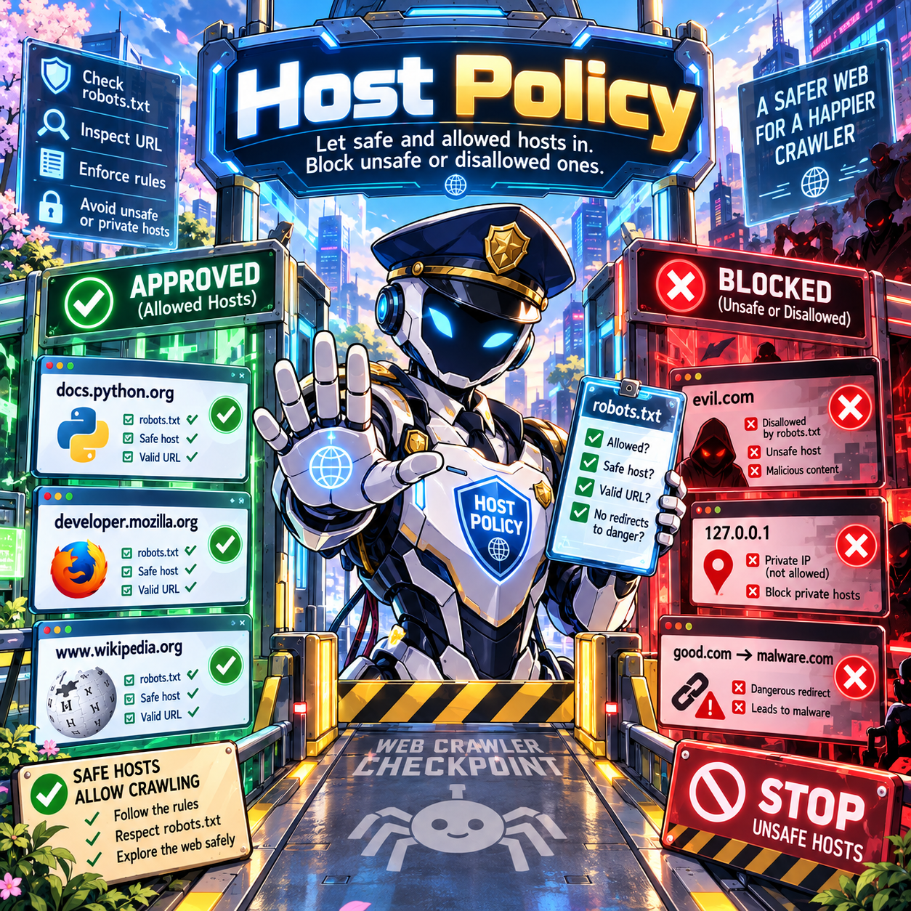
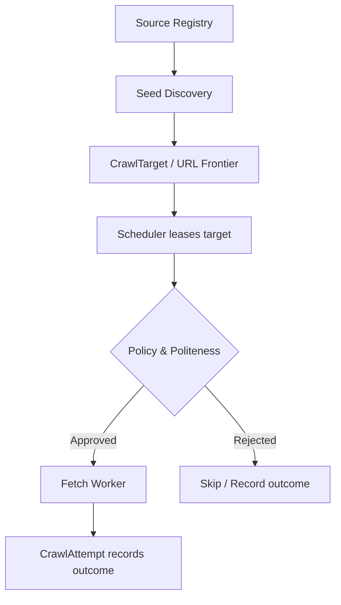
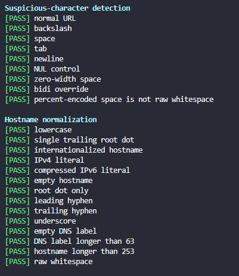
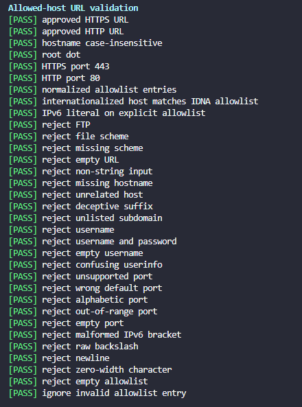
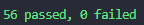

# Host Policy

### Developer's Eye · Crawler Engine · Policy & Politeness · Stage 01

> **Goal:** Validate each discovered URL and verify that its hostname belongs to an approved source **before** the fetch worker makes a network request.



---

## At a glance

| Component | Responsibility |
|---|---|
| `has_suspicious_characters()` | Reject ambiguous or potentially deceptive raw URL characters |
| `normalize_hostname()` | Normalize and validate hostnames consistently |
| `is_allowed_host()` | Verify that a URL uses an approved scheme, port, and exact hostname |
| **Next stage: DNS/IP Policy** | Verify that the resolved network destination is safe |

Host Policy is the **first security boundary** in Developer's Eye's *Policy & Politeness* pipeline. URLs found on external websites are untrusted—even when the page that contains them is trusted.

## 01 · Why do we need Host Policy?

Our crawler starts with approved sources in the **Source Registry**. Seed discovery extracts and normalizes URLs, then stores eligible URLs as **CrawlTarget** records in the frontier. The scheduler leases targets to workers.

Should a worker blindly fetch every discovered URL? **No.** Before contacting a destination, we validate whether that URL is permitted by the source's policy.



> **Important:** `CrawlTarget` represents URLs in the crawl frontier; `CrawlAttempt` records individual fetch attempts and their outcomes. Host checks can also run during discovery to reject unwanted URLs earlier.

### Scenario A · Discovered link leaves the allowlist

Suppose our approved hosts are:

```python
allowed_hosts = ["docs.python.org"]
```

While crawling Python's documentation, we discover a link to another domain:

```text
https://docs.python.org/3/tutorial/
                  │
                  ▼
           Link discovered
                  │
                  ▼
https://random-website.com/
                  │
                  ▼
     Host Policy: REJECTED
```

Without host validation, the crawler could accidentally expand into unrelated or attacker-controlled sites. Our policy compares **normalized hostnames using exact matching**:

```python
is_allowed_host("https://docs.python.org/3/", allowed_hosts)
# True

is_allowed_host("https://random-website.com/", allowed_hosts)
# False
```

### Scenario B · SSRF and cloud metadata addresses

```text
http://169.254.169.254/latest/meta-data/
```

`169.254.169.254` is a link-local address used by some cloud platforms for instance metadata. Depending on the platform and its protections, exposing this endpoint to an attacker-controlled request can create a **server-side request forgery (SSRF)** risk.

There are **two distinct security checks**:

1. **Host Policy:** Rejects the URL unless its hostname/IP literal is explicitly present in the allowed-host list.
2. **DNS/IP Policy:** Independently rejects unsafe destinations, including link-local and private addresses—even if the hostname passed the allowlist.

**Host allowlisting is not sufficient by itself:** an approved hostname can unexpectedly resolve to an unsafe IP address. Connection-time IP validation belongs to the next stage.

---

## 02 · `has_suspicious_characters()`

This helper detects characters that can make URL parsing, display, or logging ambiguous:

| Character type | Example | Why reject it? |
|---|---|---|
| Backslash (`\`) | `\` | URL parsers may disagree about separators |
| Whitespace | Space, tab, newline | May be trimmed or interpreted differently |
| Unicode control (`Cc`) | `\n`, `\r`, `\x00` | Can affect logs or other text processing |
| Unicode format (`Cf`) | `\u200B`, `\u202E` | Can make text invisible or visually misleading |

Different URL parsers and clients handle some of these inputs differently. We choose a **conservative rule: reject them in raw URLs**.

### Case 1 · Backslash parsing ambiguity

```python
url = "https://attacker.example\\@docs.python.org/secret"
```

Python's `urlsplit()` can interpret the hostname as `docs.python.org`, while a browser-style parser can treat `\` as a slash and interpret `attacker.example` as the destination.

**Risk:** A mismatch between the validation parser and the HTTP client's parser might allow a request to an unauthorized host.

**Defense:** Reject raw backslashes before URL parsing and fetching.

### Case 2 · `Cc` characters and log injection

```python
url = "https://example.com/\n[INFO] 5000 URLs indexed successfully"
print(f"CRAWL FAILED: {url}")
```

The output contains a forged second line:

```text
CRAWL FAILED: https://example.com/
[INFO] 5000 URLs indexed successfully
```

The newline (`\n`) is a Unicode **control character** (`Cc`). An attacker could create misleading text logs or confuse downstream log processing.

**Defense:** Reject raw control characters; use structured logging as an additional safeguard.

### Case 3 · `Cf` characters and deceptive URLs

```python
normal = "https://docs.python.org/3/tutorial/"
malicious = "https://docs.python.org/3/\u200Btutorial/"

print(normal == malicious)  # False
```

`\u200B` is a **zero-width space**, a Unicode format character (`Cf`). The two URLs can appear identical even though they are different strings.

**Risk:** Confusing logs, misleading displayed URLs, and duplicate-looking frontier records.

**Defense:** Reject raw Unicode format characters.

**Takeaway:** `Cc` means **Control**, and `Cf` means **Format**. These checks reduce ambiguous inputs; they do not replace normal URL parsing and network security checks.

---

## 03 · `normalize_hostname()`

Before checking a host against an allowlist, we convert it to a **consistent representation**.

The function:

1. Rejects empty hostnames and suspicious raw characters.
2. Removes **one trailing root dot**: `docs.python.org.` → `docs.python.org`.
3. Normalizes IP **literals** using Python's `ipaddress` module, including compressed IPv6 formatting.
4. Converts internationalized domain names to ASCII using **IDNA**.
5. Lowercases the hostname and checks its total length.
6. Splits DNS names into labels and validates each label against `HOST_LABEL`.

```python
normalize_hostname("DOCS.PYTHON.ORG.")
# "docs.python.org"

normalize_hostname("bücher.de")
# "xn--bcher-kva.de"

normalize_hostname("2001:0db8:0000:0000:0000:0000:0000:0001")
# "2001:db8::1"
```

### DNS label validation

```python
HOST_LABEL = re.compile(
    r"[a-z0-9](?:[a-z0-9-]{0,61}[a-z0-9])?"
)
```

For `docs.python.org`, the labels are `docs`, `python`, and `org`.

**One-line interpretation:** A DNS label must contain **1–63 ASCII letters/digits**, may contain internal hyphens, and cannot begin or end with a hyphen. Here, the hostname has already been lowercased.

> **Distinction:** `normalize_hostname()` does **not** look up DNS records or turn `docs.python.org` into an IP address. It only normalizes a hostname or an existing IP literal. Actual DNS resolution happens in DNS/IP Policy.

---

## 04 · `is_allowed_host()`

This is the main Host Policy entry point:

```python
is_allowed_host(url: str, allowed_hosts: list[str]) -> bool
```

It returns `True` only if the URL meets **all** of the relevant checks:

| Check | Policy |
|---|---|
| Input | Must be a nonempty string |
| Suspicious characters | Reject raw backslashes, whitespace, `Cc`, and `Cf` |
| Scheme | Allow only `http` and `https` |
| Credentials | Reject usernames and passwords embedded in the URL |
| Hostname | Require a valid, normalized hostname |
| Port | Allow only the scheme's default port, if explicitly supplied |
| Trailing `:` | Reject a host with an empty port, e.g. `https://docs.python.org:` |
| Allowlist | Require an **exact match** against normalized allowed hosts |

```python
ALLOWED_SCHEMES = {"http", "https"}
DEFAULT_PORTS = {"http": 80, "https": 443}
```

The ports must match the corresponding scheme:

| URL | Result |
|---|---|
| `https://docs.python.org/3/` | ✅ Allowed |
| `http://docs.python.org:80/` | ✅ Allowed |
| `https://docs.python.org:443/` | ✅ Allowed |
| `https://docs.python.org:80/` | ❌ Rejected |
| `https://docs.python.org:8443/` | ❌ Rejected |
| `https://docs.python.org:` | ❌ Rejected |
| `https://docs.python.org.evil.example/` | ❌ Rejected |

> **Design choice:** HTTP supports nondefault ports, but our crawler deliberately rejects them to keep the initial policy restrictive. The allowlist also matches **exact hosts**, not arbitrary subdomains.

---

## 05 · Host Policy Testing

We built a **data-driven test runner** with **Colorama**, without `pytest`, to validate the three functions using 56 offline test cases.

### Results







### Test coverage

| Function | Test cases | What we verify |
|---|---:|---|
| `has_suspicious_characters()` | 9 | Backslashes, whitespace, Unicode control/format characters |
| `normalize_hostname()` | 14 | Case normalization, IP literals, IDNA, invalid DNS labels |
| `is_allowed_host()` | 33 | Approved hosts, schemes, ports, credentials, malformed URLs |
| **Total** | **56** | **Host Policy behavior** |

### How the runner works

Each test is stored as a tuple:

```python
(name, function, arguments, expected_result)
```

Example:

```python
(
    "normal URL",
    has_suspicious_characters,
    ("https://docs.python.org/",),
    False,
)
```

The runner loops through `TEST_GROUPS`, calls `function(*args)`, compares the result with the expected value, and catches unexpected exceptions. **Colorama** prints green `[PASS]` or red `[FAIL]` lines. Exit code `0` means all tests passed; `1` means at least one failed.

### Run the tests

From the repository root in **PowerShell**:

```powershell
$env:PYTHONPATH = (Resolve-Path '.\crawler\src').Path
poetry -C crawler run python -m crawler.robot.tests.test_host_policy
```

The test module imports `crawler.policy_and_politeness.host_policy`; that path must match the actual package layout.

---

## 06 · Conclusion & Next Steps

Host Policy gives the crawler a **first-line validation layer** before fetching discovered URLs:

- **Reject** ambiguous raw inputs.
- **Normalize** hostnames for reliable comparisons.
- **Allow** only approved schemes, ports, and exact hosts.
- **Test** behavior with 56 deterministic offline cases.

> [!IMPORTANT]
> Passing 56 tests verifies the behavior of the covered cases; it does **not** prove complete crawler security. DNS/IP safety, robots.txt permissions, rate limits, and redirect validation are separate layers.

**Next:** **Stage 02 — DNS/IP Policy**: resolve hostnames, reject unsafe IP addresses, and ensure HTTP connections are made to validated destinations.
