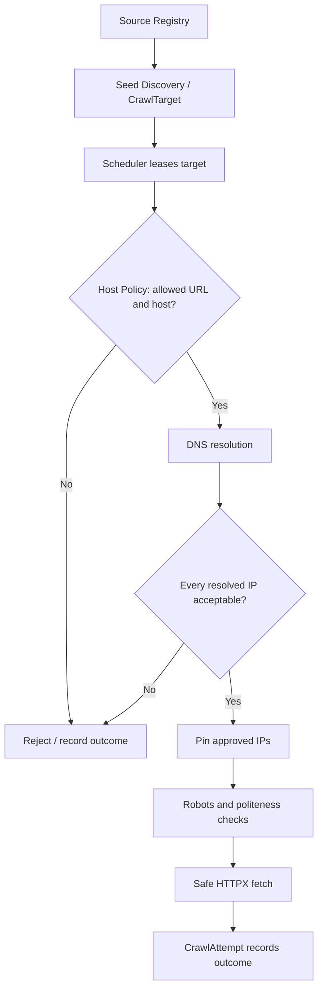
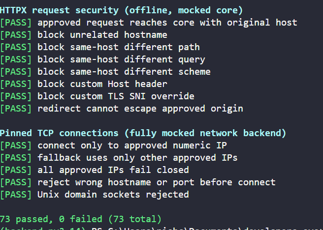

# DNS/IP Policy & Safe HTTP Transport

### Developer's Eye · Crawler Engine · Policy & Politeness · Stage 02

> **Goal:** Resolve approved hostnames, reject prohibited IP addresses, and ensure the fetch worker connects **only to a previously validated destination**.

---

---

## At a glance

| Component | Responsibility |
|---|---|
| `is_public_ip()` | Decide whether an IP literal meets our public-destination policy |
| `resolve_hostname()` | Resolve a hostname into IPv4/IPv6 addresses; **does not** decide whether they are safe |
| `validate_dns_results()` | Reject a DNS answer if **any** address is prohibited; normalize and deduplicate approved IPs |
| `resolve_safe_destination()` | Combine hostname resolution and IP validation |
| `safe_http_transport()` | Create an HTTPX transport restricted to one approved URL and validated IPs |
| `_PinnedNetworkBackend` | Make TCP connections to **numeric, approved IPs** instead of resolving the hostname again |
| `PinnedHTTPTransport` | Enforce request restrictions while keeping the original hostname for HTTP and TLS |
| **Next stages** | Robots rules, host politeness, redirect coordination, and the fetch worker |

**Core idea:** **Host Policy answers _“Are we permitted to crawl this hostname?”_ DNS/IP Policy answers _“Where does that hostname lead, and will we actually connect to the approved address?”_**

---

## 01 · Why do we need DNS/IP Policy?

A page discovered by the crawler may contain untrusted links. Host Policy first checks that the requested hostname is on the source's allowlist; **that does not establish that its IP address is safe**.

Our crawler follows this conceptual pipeline:



The precise order between DNS resolution and robots handling may depend on your policy coordinator; **both the robots fetch and the content fetch must use an appropriate network-safety boundary**.

### Scenario A · Cloud metadata SSRF

A malicious page contains this URL:

```text
http://169.254.169.254/latest/meta-data/
```

Some cloud platforms use `169.254.169.254` as a link-local metadata endpoint. If an attacker can make your server fetch it, this can become a **server-side request forgery (SSRF)** vulnerability, potentially exposing sensitive instance information depending on platform protections.

```text
Untrusted link
    ↓
169.254.169.254
    ↓
is_public_ip() → False
    ↓
REQUEST REJECTED
```

Host Policy would normally reject this literal as well unless it was explicitly allowlisted. **DNS/IP Policy is a second boundary**: it rejects unsafe network destinations even when the URL's hostname passed a prior check.

### Scenario B · An approved hostname resolves to a private IP

```python
allowed_hosts = ["docs.python.org"]
url = "https://docs.python.org/3/tutorial/"
```

Host Policy sees `docs.python.org` and accepts the hostname. But imagine a manipulated or misconfigured DNS response:

```python
["8.8.8.8", "192.168.1.10"]  # Illustrative, NOT a live docs.python.org DNS answer
```

One IP is public; the other is private. **Our design rejects the entire response**, not merely the private entry. We call this **fail-closed** behavior.

> An exact hostname allowlist prevents unauthorized *names*. IP validation independently prevents prohibited *destinations*.

---

## 02 · Exceptions and important imports

Two custom exceptions express two different kinds of failure:

```python
class UnsafeDestinationError(ValueError):
    """DNS returned a prohibited or unusable destination."""

class DNSResolutionError(OSError):
    """DNS lookup failed or timed out."""
```

| Error | Meaning | Example |
|---|---|---|
| `DNSResolutionError` | We could not resolve the hostname | DNS timeout, DNS lookup failure, invalid hostname |
| `UnsafeDestinationError` | We have a result, but policy forbids using it | Private IP, mixed safe/unsafe DNS answer, prohibited request URL |

Why distinguish them? The scheduler can record more meaningful failure reasons. **An unsafe destination should not be retried simply because it failed**, while an ordinary DNS outage might be retried under the scheduler's retry policy.

### Main libraries

| Library | Why we use it |
|---|---|
| `ipaddress` | IPv4/IPv6 parsing, classification, and normalization |
| `asyncio` | Async DNS lookup with a deadline |
| `socket` | Select TCP and both IPv4/IPv6 DNS answers |
| `ssl` | TLS certificate verification context |
| `httpx` | Public-facing async HTTP client and transport interface |
| `httpcore` | Underlying connection pool and network backend |
| `urlsplit` | Extract scheme and hostname from the URL |
| `Sequence`, `AsyncIterator` | Type annotations for address collections and async response bodies |
| `contextmanager` | Translate HTTPCore errors into HTTPX errors |

The DNS module also **reuses** `normalize_hostname()` and `is_allowed_host()` from Stage 01, rather than implementing URL validation twice.

---

## 03 · `is_public_ip()` — Validate one IP address

```python
def is_public_ip(address: str) -> bool:
    if not isinstance(address, str) or not address or "%" in address:
        return False

    try:
        ip = ipaddress.ip_address(address)
    except ValueError:
        return False

    if isinstance(ip, ipaddress.IPv6Address):
        if ip.ipv4_mapped is not None:
            ip = ip.ipv4_mapped
        elif ip.sixtofour is not None or ip.teredo is not None:
            return False

    return ip.is_global and not ip.is_multicast and not ip.is_reserved
```

### What each part does

1. **Reject malformed inputs.** Require a nonempty string and reject `%` (used in scoped IPv6 address notation such as `fe80::1%eth0`).
2. **Parse the address.** `ipaddress.ip_address()` produces an `IPv4Address` or `IPv6Address`; invalid inputs raise `ValueError`.
3. **Handle IPv4-mapped IPv6.** `::ffff:192.168.1.10` contains an IPv4 address, so we validate the embedded IPv4 address rather than trusting its IPv6 appearance.
4. **Reject special IPv6 transition encodings.** This implementation rejects 6to4 and Teredo rather than trying to reason about the underlying routes.
5. **Require global, non-multicast, non-reserved status.** Our conservative rule is stricter than simply calling `.is_global`.

### Scenario C · A private IP disguised as IPv6

```python
is_public_ip("::ffff:192.168.1.10")
# False
```

The address looks like IPv6, but `.ipv4_mapped` extracts `192.168.1.10`. That is a private IPv4 address and must be rejected.

### Common results

| IP | Expected | Why |
|---|---|---|
| `8.8.8.8` | ✅ `True` | Public unicast IPv4 |
| `192.168.1.10` | ❌ `False` | Private network |
| `127.0.0.1` | ❌ `False` | Local loopback |
| `169.254.169.254` | ❌ `False` | Link-local / possible metadata endpoint |
| `224.0.0.1` | ❌ `False` | Multicast |
| `::1` | ❌ `False` | IPv6 loopback |
| `fc00::1` | ❌ `False` | IPv6 unique-local address |
| `::ffff:192.168.1.10` | ❌ `False` | IPv4-mapped private address |
| `2606:4700:4700::1111` | ✅ `True` | Public unicast IPv6 |
| `fe80::1%eth0` | ❌ `False` | Scoped IPv6 literal |

> **Important:** “Public” here means **acceptable under this code's IP classification rules**, not that the remote website is trustworthy, harmless, reachable, or authorized by the source allowlist.

---

## 04 · `resolve_hostname()` — Perform DNS lookup

```python
async def resolve_hostname(hostname: str, timeout: float = 5.0) -> list[str]:
```

Its responsibility is to **retrieve addresses without making a safety decision**.

### Step 1 · Normalize the hostname

```python
host = normalize_hostname(hostname) if isinstance(hostname, str) else None
if host is None:
    raise DNSResolutionError("Invalid hostname")
```

We reuse Host Policy's normalization rules. `DOCS.PYTHON.ORG.` becomes `docs.python.org`.

### Step 2 · Avoid unnecessary DNS for IP literals

```python
try:
    return [str(ipaddress.ip_address(host))]
except ValueError:
    pass
```

A literal such as `8.8.8.8` is already an address. This helper returns it directly; the **next function** still needs to verify its safety.

### Step 3 · Resolve both IPv4 and IPv6 asynchronously

```python
loop = asyncio.get_running_loop()
records = await asyncio.wait_for(
    loop.getaddrinfo(
        host,
        None,
        family=socket.AF_UNSPEC,
        type=socket.SOCK_STREAM,
        proto=socket.IPPROTO_TCP,
    ),
    timeout=timeout,
)
```

| Expression | Meaning |
|---|---|
| `async def` | Function can suspend while an asynchronous operation runs |
| `await` | Wait for the lookup without blocking other coroutine work |
| `AF_UNSPEC` | Request IPv4 and IPv6 addresses |
| `SOCK_STREAM` | Stream-oriented socket (used by TCP) |
| `IPPROTO_TCP` | Select the TCP protocol |
| `asyncio.wait_for()` | Set a maximum wait of five seconds by default |

The function catches DNS-related `OSError` and timeout exceptions and raises `DNSResolutionError`.

### Step 4 · Extract and deduplicate addresses

```python
ips = []
seen = set()

for family, _socktype, _proto, _canonname, sockaddr in records:
    if family not in (socket.AF_INET, socket.AF_INET6):
        continue
    ip = sockaddr[0]
    if ip not in seen:
        seen.add(ip)
        ips.append(ip)
```

`getaddrinfo()` returns tuples with several fields; `sockaddr[0]` contains the IP. A **set** is used for fast duplicate checks, while a **list** retains address order.

### Scenario D · DNS lookup failure

```text
Hostname → DNS resolver → timeout
                           ↓
                 DNSResolutionError
```

The crawler can log this separately from an unsafe-IP rejection. The scheduler determines whether and when to retry it.

---

## 05 · `validate_dns_results()` and `resolve_safe_destination()`

### Validate every returned address

```python
def validate_dns_results(addresses: Sequence[str]) -> list[str]:
    if not addresses:
        raise UnsafeDestinationError("DNS returned no IP addresses")

    approved = []
    seen = set()
    for address in addresses:
        if not is_public_ip(address):
            raise UnsafeDestinationError(f"Unsafe DNS address: {address!r}")
        normalized = ipaddress.ip_address(address).compressed
        if normalized not in seen:
            seen.add(normalized)
            approved.append(normalized)
    return approved
```

`Sequence[str]` means an ordered collection of strings (for example, a list or tuple). `.compressed` standardizes IP notation, especially IPv6.

### Scenario E · Mixed DNS response

```python
validate_dns_results(["8.8.8.8", "192.168.1.10"])
# Raises UnsafeDestinationError
```

```text
DNS answer
  ├── 8.8.8.8        → Public
  └── 192.168.1.10   → Private
            ↓
      REJECT ALL
```

Why reject the whole response? It avoids silently proceeding when an allowed hostname maps to a prohibited destination. **This is a deliberate fail-closed design choice**, not a technical requirement imposed by DNS itself.

### One public entry point for both steps

```python
async def resolve_safe_destination(hostname: str) -> list[str]:
    return validate_dns_results(await resolve_hostname(hostname))
```

Read from the inside out:

```text
hostname
   ↓ resolve_hostname()
raw IP addresses
   ↓ validate_dns_results()
approved, normalized IP addresses
```

This composition keeps DNS lookup and safety classification independently testable.

---

## 06 · The real problem: DNS rebinding (TOCTOU)

DNS/IP validation is not complete if a later HTTP client **resolves the hostname a second time**.

### Scenario F · The DNS answer changes between check and connection

```text
1. Our code resolves example.test
   → 8.8.8.8                  ✅ Approved

2. Later HTTPX resolves example.test again
   → 192.168.1.10             ❌ Private

3. HTTPX connects to 192.168.1.10
   → Validation was bypassed
```

The IPs above are hypothetical. This is a **time-of-check to time-of-use (TOCTOU)** failure, which can occur in DNS rebinding attacks.

### Our solution: pin the connection to approved IPs

```text
Hostname → DNS lookup → Validate ALL addresses
                                ↓
                       Approved IP list
                                ↓
                  _PinnedNetworkBackend
                                ↓
                 Connect to NUMERIC IP only
                                ↓
                    No second DNS lookup
```

The implementation creates a custom `httpcore.AsyncNetworkBackend` to establish the socket directly to the numeric IP address, while retaining the original hostname for HTTP routing and TLS certificate validation.

> **Important distinction:** Connecting to a numeric IP does **not** mean replacing the HTTPS URL's hostname with the numeric IP. Doing that can break virtual-host routing or TLS certificate checks. Our transport keeps these concerns separate.

---

## 07 · `_PinnedNetworkBackend` — Enforce approved TCP destinations

```python
class _PinnedNetworkBackend(httpcore.AsyncNetworkBackend):
```

This private helper subclasses HTTPCore's network-backend interface. It stores:

```python
self.host = host
self.port = port
self.ips = tuple(ips)
self.backend = httpcore.AnyIOBackend()
```

- `host`: original, normalized hostname.
- `port`: permitted destination port.
- `ips`: immutable tuple of previously approved IPs.
- `backend`: actual low-level network connector.

### `connect_tcp()`

Before opening a socket:

```python
if normalize_hostname(host) != self.host or port != self.port:
    raise httpcore.ConnectError(
        "Connection destination differs from approved origin"
    )
```

Then the backend tries only numeric IPs from `self.ips`:

```python
for ip in self.ips:
    try:
        return await self.backend.connect_tcp(
            host=ip,
            port=port,
            timeout=timeout,
            local_address=local_address,
            socket_options=socket_options,
        )
    except (httpcore.ConnectError, httpcore.ConnectTimeout) as exc:
        last_error = exc
```

### Scenario G · First public IP is unreachable

```text
Validated DNS response
  ├── Public IP A → TCP connection fails
  └── Public IP B → TCP connection succeeds
```

The transport may try the **next already approved IP**. It does **not** search for another destination and does **not** re-resolve DNS.

If all approved connections fail, it raises the last connection error. If the requested hostname or port differs, it refuses the connection before opening a socket.

### Unix sockets are prohibited

```python
async def connect_unix_socket(...):
    raise httpcore.ConnectError("Unix sockets are not permitted")
```

This policy is intended for public HTTP(S) over TCP, not local Unix-domain socket access.

---

## 08 · `PinnedHTTPTransport` — Enforce the original HTTP request

```python
class PinnedHTTPTransport(httpx.AsyncBaseTransport):
```

This private transport adapter is responsible for keeping **request validation, HTTP metadata, TLS identity, and numeric-IP connections** consistent.

### Constructor: `__init__()`

Its important steps are:

1. Parse the URL with `urlsplit()`.
2. Normalize the hostname and apply `is_allowed_host()` against that hostname.
3. Revalidate the supplied IP list with `validate_dns_results()`.
4. Store the original approved URL, scheme, hostname, and port.
5. Create an HTTPCore connection pool with a pinned network backend.

```python
self.pool = httpcore.AsyncConnectionPool(
    ssl_context=ssl.create_default_context(),
    network_backend=_PinnedNetworkBackend(self.host, self.port, ips),
    max_connections=10,
    max_keepalive_connections=0,
    retries=0,
)
```

**Configuration explained:**

| Setting | Meaning |
|---|---|
| `ssl.create_default_context()` | Use default TLS verification, including certificate checks |
| `network_backend=...` | Connect using the pinned IP list |
| `max_connections=10` | Maximum connections **within this transport's pool**, not a global per-host crawl limit |
| `max_keepalive_connections=0` | Do not retain idle keep-alive connections |
| `retries=0` | Disable HTTPCore's automatic connection retry mechanism; the pinned backend itself can still try another approved IP |

**The constructor revalidates the list provided by its caller, but does not independently prove that those IPs belong to the URL's hostname.** The policy coordinator must supply results from the proper resolution and validation step.

### `handle_async_request()`

Before sending an HTTP request, it verifies:

| Check | Reason |
|---|---|
| Valid URL / allowed host | Reject disallowed request syntax or hostname |
| Exact `request.url == approved_url` | Do not reuse this transport for another path, query, or destination |
| Original scheme and port | Prevent cross-origin changes |
| No custom `sni_hostname` extension | Prevent unexpected TLS server-name overrides |
| Expected `Host` header | Prevent routing the request to a different HTTP virtual host |

### Scenario H · Redirect escape attempt

Suppose an approved page answers:

```http
HTTP/1.1 302 Found
Location: https://unapproved.example/internal
```

Your crawler must **not** automatically follow the redirect without policy checks. This transport authorizes only its original URL, so a different URL is rejected if attempted through the same transport.

```text
Approved initial URL
       ↓
HTTP 302 → new URL
       ↓
Fresh Host + DNS/IP + Robots checks REQUIRED
       ↓
New validated transport, or reject
```

**Important:** This transport does **not** implement full redirect handling. Your later Redirect Policy/Coordinator must parse each `Location`, apply all appropriate checks for that hop, and control whether to fetch it. Configure `follow_redirects=False` when using this flow.

### Scenario I · Forged Host header

```python
headers = {"Host": "unapproved.example"}
```

Even if the URL names an approved destination, a custom `Host` header could target a different virtual host on the same server. This transport rejects headers that differ from the approved request authority.

### Why keep the original hostname for HTTPS?

```text
HTTP URL hostname: docs.python.org
TCP socket address: validated numeric IP
TLS certificate identity: docs.python.org
HTTP Host header: docs.python.org
```

This allows the TCP connection to avoid a second hostname lookup **without discarding normal hostname-based TLS verification or virtual-host routing**.

---

## 09 · Error translation and response streaming

These private helpers make the custom HTTPCore transport behave more like a normal HTTPX transport.

### `_map_httpcore_errors()`

HTTPCore and HTTPX define separate exception classes. Your mapping converts expected categories, such as:

```text
httpcore.ConnectTimeout → httpx.ConnectTimeout
httpcore.ConnectError   → httpx.ConnectError
httpcore.ReadTimeout    → httpx.ReadTimeout
httpcore.RemoteProtocolError → httpx.RemoteProtocolError
```

The implementation uses `@contextmanager` and `yield` so network operations can be wrapped in a `with` block. This is needed because the caller uses HTTPX's public transport interface.

### `_ResponseStream`

```python
class _ResponseStream(httpx.AsyncByteStream):
```

HTTP responses may arrive in chunks instead of one large block. `_ResponseStream` adapts HTTPCore's asynchronous response stream for HTTPX and maps streaming errors.

- `__aiter__()` yields response bytes incrementally.
- `aclose()` closes the underlying response stream when supported.
- `PinnedHTTPTransport.aclose()` closes the connection pool.

These helpers support proper resource cleanup. **They do not, by themselves, limit response size**; the fetch worker still needs byte and content limits.

---

## 10 · `safe_http_transport()` — The public transport factory

```python
def safe_http_transport(
    url: str,
    approved_ips: Sequence[str],
) -> httpx.AsyncBaseTransport:
    return PinnedHTTPTransport(url, approved_ips)
```

This small function is the entry point used by the fetch worker after Host Policy and DNS/IP validation.

### Example · One controlled request

```python
import httpx
from urllib.parse import urlsplit

from crawler.policy_and_politeness.host_policy import is_allowed_host
from crawler.policy_and_politeness.dns_policy import (
    resolve_safe_destination,
    safe_http_transport,
)

async def fetch_one(url: str, allowed_hosts: list[str]) -> int:
    if not is_allowed_host(url, allowed_hosts):
        raise ValueError("URL is not allowlisted")

    hostname = urlsplit(url).hostname
    assert hostname is not None  # Already established by Host Policy

    approved_ips = await resolve_safe_destination(hostname)
    transport = safe_http_transport(url, approved_ips)

    async with httpx.AsyncClient(
        transport=transport,
        follow_redirects=False,
        trust_env=False,
        timeout=10.0,
    ) as client:
        response = await client.get(url)
        return response.status_code
```

This is a **DNS/transport usage example**, **not** the entire fetch worker. A full worker needs robots permission, politeness reservations, explicit redirect handling, response-size limits, error recording, and URL/path policy checks.

> **Package-path note:** The uploaded DNS implementation and the earlier test files have used both `crawler.robot.*` and `crawler.policy_and_politeness.*` paths. Use the package names that actually exist in your repository, and update imports and test commands consistently.

---

## 11 · DNS/IP Policy Testing

We also have a **Colorama-based test runner**, without `pytest`, containing **73 offline test cases**. It uses mocks so it does not require live DNS, HTTP traffic, or PostgreSQL.



### Test coverage

| Category | Cases | Purpose |
|---|---:|---|
| `is_public_ip()` | 31 | Public/private/loopback/link-local/IPv6 edge cases |
| `validate_dns_results()` | 10 | Fail-closed validation, duplicates, IP normalization |
| `resolve_hostname()` | 7 | DNS results, literals, invalid hosts, errors and timeout |
| `resolve_safe_destination()` | 4 | Integration of resolution and IP safety |
| `safe_http_transport()` construction | 8 | Accept only valid URLs and approved IP lists |
| HTTPX request security | 8 | Exact URL, headers, scheme, SNI and redirect restrictions |
| Pinned TCP connections | 5 | Approved-IP connections, fallback, rejection, Unix socket blocking |
| **Total** | **73** | **Offline behavior checks** |

### Test runner structure

The runner uses functions such as:

```python
await runner.check("approved request reaches core", test_valid_request)
```

It executes sync or async tests, catches failures, prints **green `[PASS]`** and **red `[FAIL]`** using Colorama, and returns exit status `0` for a fully passing run or `1` for any failure.

### Run the tests

From the repository root in PowerShell, using the test module's package layout:

```powershell
$env:PYTHONPATH = (Resolve-Path '.\crawler\src').Path
poetry -C crawler run python -m crawler.robot.tests.test_dns_policy
```

If you moved the tests to `crawler.policy_and_politeness.tests`, update the module path in the command accordingly. Also ensure the test file's import of `dns_policy` matches the actual location.

### Example output

```text
IP address safety (is_public_ip)
[PASS] private IPv4 rejected
[PASS] cloud metadata / link-local IPv4
...

Pinned TCP connections (fully mocked network backend)
[PASS] connect only to approved numeric IP
[PASS] fallback uses only other approved IPs
...

73 passed, 0 failed (73 total)
```

This is an **illustrative successful output**. Running the suite against the current repository is necessary to confirm the current environment passes.

---

## 12 · Limitations & Next Steps

Our DNS/IP module provides an important defense, but it is **not a complete SSRF-proof crawler on its own**.

- **Host allowlisting still applies.** `safe_http_transport()` validates URL syntax and the host against itself, not the source registry's authorized host list. The coordinator must check the real allowlist first.
- **Robots policy is separate.** Check crawl permissions before requesting content; robots fetching itself must also respect network safety constraints.
- **Politeness is separate.** `max_connections=10` is a pool limit, not a per-host concurrency or crawl-delay policy.
- **Redirects need coordination.** A new redirect hop needs fresh URL, host, DNS/IP, robots, and politeness decisions.
- **Response size and content safety are separate.** Limit bytes, decompression, time, and accepted content types in the fetcher.
- **Deployment controls add another boundary.** Deny sensitive internal egress at the network/firewall layer where possible.
- **Low-level dependency coupling exists.** The pinned transport uses HTTPCore networking interfaces; pin compatible `httpx`/`httpcore` versions and run integration tests when upgrading.
- **Tests do not prove internet-wide safety.** Mocked tests are valuable but cannot establish production TLS compatibility or complete SSRF resistance.

### Engineering checklist

- [x] Normalize and validate discovered hostnames (Stage 01)
- [x] Reject prohibited IP literals
- [x] Resolve both IPv4 and IPv6
- [x] Fail closed on mixed DNS responses
- [x] Pin outgoing TCP connections to validated addresses
- [x] Restrict transport to one approved URL
- [ ] Integrate source-level allowlists at the coordinator
- [ ] Implement robots fetching, parsing, caching, and permission checks
- [ ] Implement per-host concurrency and crawl delay
- [ ] Implement per-hop redirect validation
- [ ] Add fetch-size limits and production integration tests

> [!IMPORTANT]
> **Takeaway:** Checking an IP once is not enough. **Resolve → validate → connect to that exact approved IP**. This is what makes DNS/IP Policy a meaningful security boundary rather than just a filtering function.

**Next:** **Stage 03 — Robots Policy**: fetch `robots.txt` safely, parse the rules, cache the response, and decide whether the crawler may access a given URL path.
