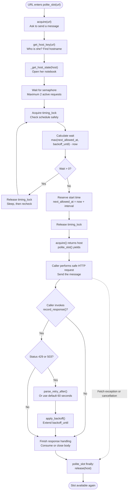

# Politeness Policy. Fourth step of our crawler safety checks

---


We already made **Host Policy**, **DNS Policy**, and **Robots Policy**. Now comes **Politeness Policy**.

Let's recap what happens when a URL comes from the URL Frontier:

- **Host Policy:** Is the website on our approved host list?
- **DNS Policy:** Does it resolve to safe public IP addresses, and will our actual connection use an approved IP?
- **Robots Policy:** Do the website's published crawling rules allow this particular URL?
- **Politeness Policy:** Even if we *can* fetch the URL, **should we send another request to this website right now?**

Important distinction: a robots.txt `Allow` is a crawling instruction, **not unrestricted permission to access private content**. And politeness never overrides a robots `DENY`.

---

## 1. Why are we making Politeness Policy?

Imagine Developer's Eye has **1,000 URLs from MDN** waiting in the frontier.

Without politeness, our async workers could fire hundreds of requests at the same website in a short burst. We might overload it, get `429 Too Many Requests`, or get blocked.

Even if the scheduler distributed URLs earlier, multiple workers can wake up together. A scheduler controls **what is due**. Politeness controls **what may start now**.

So we take it to the next level: don't go rough. Cool down, breathe, and fetch.

If the website says "slow down," we slow down. If its robots rules say "do not crawl," we don't crawl at all.

We check **three** things:

| Rule | Simple meaning | Current setting |
| --- | --- | --- |
| **Concurrency** | How many active requests can this **hostname** have at once? | `2` |
| **Delay** | How much time must pass between **starting** requests? | `2.0` seconds |
| **Backoff** | How long do we pause new requests after `429` or `503`? | `60.0` seconds by default |

```python
DEFAULT_MAX_CONCURRENT_PER_HOST = 2
DEFAULT_MIN_INTERVAL_SECONDS = 2.0
DEFAULT_BACKOFF_SECONDS = 60.0
MAX_BACKOFF_SECONDS = 3_600.0
```

**Correction to my initial intuition:** The delay is **between request starts**, not "wait two seconds after every fetch finishes." Also, the limit is per **hostname**, not per individual URL path. `/docs/python` and `/docs/javascript` on the same host share one limit.

---

## 2. ELI5: What if our crawler was texting a girl?

Imagine you're texting someone you like. Now pretend you have **1,000 messages** you want to send. Sending every message at once is not a good idea.

For this story, the girl is a **website**, the messages are **HTTP requests**, and you are **Developer's Eye**.

You need to be a polite guy.

### Rule 1: Concurrency — don't flood her inbox

Only **two conversations** can be active at once.

In crawler language, only **two requests** to that hostname can be in progress. If two requests are busy, the third waits for a slot.

This is our **semaphore**.

### Rule 2: Delay — don't spam messages back-to-back

You can start a new message only after **at least two seconds** have passed since the last start.

Even if another conversation slot is available, you still have to respect the timing rule.

This is our **`next_allowed_at`** deadline, protected by a **timing lock**.

### Rule 3: Backoff — she says "I'm busy"

She replies: **"Too many messages. Try again later."**

That is our HTTP `429 Too Many Requests` analogy. The server may specify `Retry-After: 120`, meaning wait 120 seconds before starting another request. HTTP `503 Service Unavailable` also triggers backoff in our implementation.

This is our **`backoff_until`** deadline.

And here's where the analogy ends: if a website's robots rules say **DENY**, that's not "try again after a minute." That's **don't fetch that URL**. Politeness is for traffic pacing, not bypassing boundaries.

---

## 3. Our notebook: `_HostState`

Before texting, we take a notebook for **each hostname**. We track who is busy, when the next message is allowed, and when a temporary pause ends.

```python
@dataclass(slots=True)
class _HostState:
    semaphore: asyncio.BoundedSemaphore
    timing_lock: asyncio.Lock
    next_allowed_at: float = 0.0
    backoff_until: float = 0.0
```

| Notebook entry | Girl-texting story | Actual technical meaning |
| --- | --- | --- |
| `semaphore` | How many conversations can be active? | Limit simultaneous in-flight requests |
| `timing_lock` | Only one person updates the texting schedule at a time | Protect shared timing variables against concurrent task updates |
| `next_allowed_at` | What's the earliest time another text can start? | Next eligible request-start time |
| `backoff_until` | When does the "I'm busy" pause end? | Earliest start allowed after a temporary rate-limit response |

**The lock is not the same as the semaphore.** The semaphore permits up to two active requests. The lock allows one task at a time to **read/update timing state**. It does **not** restrict all fetching to one request.

Our manager stores the notebooks in:

```python
self._states: dict[str, _HostState] = {}
```

For example:

```text
Host: developer.mozilla.org
  Active request limit: 2
  Next eligible request start: 10:00:04
  Temporary backoff: none

Host: docs.python.org
  Active request limit: 2
  Next eligible request start: 10:00:02
  Temporary backoff: none
```

The clock times above are **story illustrations**. In the real implementation, the deadlines are stored using `time.monotonic()`, not human-readable wall-clock times.

So MDN can be paused while Python Docs continues.

---

## 4. Following the actual flowchart using the story

First the URL arrives at `polite_slot(url)`. Think of it as asking the guard: "Can I send this message?"

1. **`polite_slot(url)`** — Walk up to the guard with the message.
2. **`acquire(url)`** — Ask for permission to start.
3. **`get_host_key(url)`** — "Who is she?" Identify the hostname.
4. **`_get_host_state(host)`** — Find that hostname's notebook, or make one.
5. **Semaphore** — Are two conversations already active? If yes, wait until one ends.
6. **`timing_lock`** — Open the schedule for a safe, one-at-a-time update.
7. **Calculate `wait`** — Check both the next-message deadline and the "I'm busy" deadline.
8. **If `wait > 0`** — Put the notebook down, sleep without blocking other tasks, and recheck.
9. **Otherwise** — Reserve this message's start time; move `next_allowed_at` forward by two seconds.
10. **Fetch** — The caller starts the HTTP request using its separately secured fetcher.
11. **`record_response()`** — If the server says `429` or `503`, update the backoff deadline.
12. **`release()`** — When the response is fully handled, give back the conversation slot, even if something failed.

### Our complete flowchart



**One nuance:** `record_response()` is **not automatically called** by `polite_slot()`. The caller must invoke it. The context manager automatically handles only acquiring and releasing the slot.

---

## 5. Now the technical part: every function in `politeness.py`

### 5.1 `get_host_key(url)` — Who is she?

```python
parts = urlsplit(normalize_url(url))
host = normalize_hostname(parts.hostname)
return host
```

Example:

```python
get_host_key("https://developer.mozilla.org/en-US/docs/Web")
# "developer.mozilla.org"
```

This ensures different paths on the same host share one state:

```text
https://developer.mozilla.org/docs/python ─┐
                                          ├── developer.mozilla.org
https://developer.mozilla.org/docs/css ────┘
```

Our implementation also groups **HTTP/HTTPS and different ports** for the same hostname. Subdomains are separate: `example.com` and `docs.example.com` get different notebooks.

### 5.2 `parse_retry_after(value)` — "How long should I wait?"

HTTP servers can send a `Retry-After` header in two formats:

```http
Retry-After: 120
```

That means **120 seconds**.

Or:

```http
Retry-After: Wed, 21 Oct 2026 07:28:00 GMT
```

That's a date/time. We calculate how many seconds remain until then.

Our function:

```python
parse_retry_after("120")    # 120.0
parse_retry_after("nonsense")  # None
parse_retry_after(None)      # None
```

If the header is missing or invalid, `record_response()` uses the configured **default backoff**. The actual pause is capped by `max_backoff_seconds` (default **3,600 seconds**).

### 5.3 `PolitenessManager.__init__()` — Set the rules

```python
manager = PolitenessManager(
    max_concurrent_per_host=2,
    min_interval_seconds=2.0,
    default_backoff_seconds=60.0,
    max_backoff_seconds=3_600.0,
)
```

The constructor validates the configuration. For example, a concurrency limit of `0`, a negative delay, or `NaN` is rejected with `ValueError`.

It starts with an empty dictionary of host notebooks.

### 5.4 `_get_host_state(host)` — Find or create the notebook

```python
state = self._states.get(host)
if state is None:
    state = _HostState(
        semaphore=asyncio.BoundedSemaphore(self.max_concurrent_per_host),
        timing_lock=asyncio.Lock(),
    )
    self._states[host] = state
return state
```

If the notebook exists, reuse it. Otherwise, make one.

`asyncio.BoundedSemaphore(2)` starts with two permits and raises an error if code attempts to release more permits than the configured limit.

`asyncio.Lock()` makes checking and updating the shared timing values safe from overlapping asyncio tasks in this event loop.

### 5.5 `_wait_for_turn(state)` — Am I allowed to start now?

This is the timing brain.

```python
async with state.timing_lock:
    now = time.monotonic()
    wait = max(state.next_allowed_at, state.backoff_until) - now
    if wait <= 0:
        state.next_allowed_at = now + self.min_interval_seconds
        return
await asyncio.sleep(wait)
```

The real implementation puts this inside `while True`, because after sleeping it must **recheck**. Another task may have changed the schedule or extended backoff while we waited.

Why `max()`? Both conditions must be satisfied. The later deadline wins.

**Scenario:**

```text
Current monotonic time:    100
Next normal start:         102
Backoff ends:              160

wait = max(102, 160) - 100 = 60 seconds
```

The `timing_lock` is released **before** sleeping so other tasks can update the host's state. `asyncio.sleep()` yields control to the event loop. It does not freeze the whole crawler.

We use `time.monotonic()` because elapsed-time calculations should not jump if the machine's wall clock changes.

### 5.6 `acquire(url)` — Get the permission slip

```python
host = get_host_key(url)
state = self._get_host_state(host)
await state.semaphore.acquire()
try:
    await self._wait_for_turn(state)
except BaseException:
    state.semaphore.release()
    raise
return host
```

This first reserves a concurrency permit, then waits for a valid request start time.

The `except BaseException` is deliberate: **task cancellation** (`asyncio.CancelledError`) also needs to release the permit. Otherwise, cancelling waiting tasks could permanently occupy slots.

A task waiting for its timing turn **already occupies a semaphore permit** in this design. That is safe for the limit, but it means at most two tasks per host are inside this stage at once.

### 5.7 `release(host)` — Return the permission slip

When a fetch is done, its slot is returned:

```python
state = self._states.get(host)
if state is None:
    raise ValueError("Unknown host key; acquire() must run first")
state.semaphore.release()
```

A `BoundedSemaphore` helps catch releasing more times than slots were acquired.

**Do not release the slot as soon as response headers arrive.** If you're streaming an HTML body, keep the slot until the body is completely consumed or the response is closed.

### 5.8 `apply_backoff(url, seconds)` — She's busy, update the pause

```python
duration = min(float(seconds), self.max_backoff_seconds)
async with state.timing_lock:
    state.backoff_until = max(
        state.backoff_until,
        time.monotonic() + duration,
    )
```

This pauses **new request starts** to that host. Existing in-flight requests are not cancelled.

The `max()` prevents a new shorter pause from accidentally shortening an existing longer one.

### 5.9 `record_response(url, status_code, retry_after)` — Read her reply

```python
if status_code not in (429, 503):
    return
seconds = parse_retry_after(retry_after)
if seconds is None:
    seconds = self.default_backoff_seconds
await self.apply_backoff(url, seconds)
```

- `429`: We're being rate-limited. Back off.
- `503`: Service unavailable. Back off.
- `200`: No special backoff.
- `500`, `502`, `504`: **No backoff in this version** unless other parts of the crawler handle them.

The server's valid `Retry-After` value takes precedence over our default, subject to the configured maximum.

### 5.10 `polite_slot(url)` — The automatic bodyguard

```python
@asynccontextmanager
async def polite_slot(self, url: str) -> AsyncIterator[None]:
    host = await self.acquire(url)
    try:
        yield
    finally:
        self.release(host)
```

This is the function our fetch worker will normally use. The caller doesn't have to remember to release manually.

```python
async with manager.polite_slot(url):
    response = await safe_fetcher(url)
    await manager.record_response(
        url,
        response.status_code,
        response.headers.get("Retry-After"),
    )
```

In this shorter example, `safe_fetcher()` must return only after fully consuming or closing the response. The streaming example in Section 7 shows how to hold the slot while reading the body.

**Failure scenario:** The fetcher raises an exception halfway through a request. The `finally` block still releases the permit, so subsequent tasks are not stuck forever.

---

## 6. Real scenario: five MDN pages, two active slots

Assume each request takes **5 seconds**. Our limits are **2 simultaneous requests** and **2 seconds between starts**.

| Time | What happens | Active requests |
| --- | --- | --- |
| `0s` | Request 1 starts | 1 |
| `2s` | Request 2 starts | 1, 2 |
| `4s` | Request 3 would satisfy the delay, **but both slots are busy** | 1, 2 |
| `5s` | Request 1 finishes and releases a slot; Request 3 starts | 2, 3 |
| `7s` | Request 2 finishes; Request 4 starts | 3, 4 |
| `10s` | Request 3 finishes; Request 5 starts | 4, 5 |

So the limiter respects **both rules**, not just one. These times are illustrative; actual scheduling and network latency can vary.

### Scenario: MDN gets mad, Python Docs doesn't

```text
MDN response:
  HTTP 429
  Retry-After: 120

Politeness manager:
  MDN: no new request starts for 120 seconds
  Python Docs: still allowed to use its own slots and timer
```

The manager doesn't cancel MDN requests already in progress. It only restricts upcoming starts.

---

## 7. How the async fetch worker will call it

Here is an **integration example** for a client that is **already secured** by the DNS/IP and host/redirect policies. This snippet demonstrates *politeness*, not a complete production-safe fetcher.

```python
import httpx

from crawler.policy_and_politeness.politeness import PolitenessManager


async def fetch_one(
    url: str,
    manager: PolitenessManager,
    safe_client: httpx.AsyncClient,
) -> tuple[int, bytes]:
    max_body_bytes = 1_000_000
    chunks: list[bytes] = []
    body_bytes = 0

    async with manager.polite_slot(url):
        async with safe_client.stream(
            "GET", url, follow_redirects=False
        ) as response:
            await manager.record_response(
                url,
                response.status_code,
                response.headers.get("Retry-After"),
            )

            async for chunk in response.aiter_bytes():
                body_bytes += len(chunk)
                if body_bytes > max_body_bytes:
                    raise ValueError("Response exceeded configured body limit")
                chunks.append(chunk)

            return response.status_code, b"".join(chunks)
```

The context manager wraps the **whole response lifetime**, not just the initial request. The example caps the downloaded decoded body in memory, but **does not replace** transport-level response-size controls, DNS/IP pinning, host checks, or redirect policy.

For a `301` or `302`, `follow_redirects=False` means the fetcher returns the redirect response. The **redirect policy/coordinator** must validate the next URL and acquire the next destination's own polite slot before another request.

The robots.txt fetcher should also use the appropriate traffic controls. Robots lookups are real requests to the site; they must not get an unlimited bypass around politeness.

---

## 8. What we tested

I ran **20 local tests** against the `politeness.py` implementation with `pytest`. All **20 passed**. They used small stand-ins for `normalize_url()` and `normalize_hostname()` because your complete repository was not mounted here. No real website was contacted.

| Tested behavior | What we checked | Result |
| --- | --- | --- |
| Host keys | Same hostname across paths/schemes shares one limit; different hostnames are separate | PASS |
| `Retry-After` values | Missing, invalid, numeric and whitespace-padded values | PASS |
| HTTP-date header | Future HTTP date is converted into remaining seconds | PASS |
| Bad configuration | Zero/bool concurrency, negative or nonfinite delays, invalid max backoff | PASS |
| Semaphore | Nine tasks never exceed two simultaneous active slots | PASS |
| Spacing | Three starts follow the configured minimum interval | PASS |
| Per-host isolation | MDN backoff does not block Python Docs | PASS |
| HTTP 429 | A numeric `Retry-After` delays the affected host | PASS |
| HTTP 503 | Missing `Retry-After` uses the configured default | PASS |
| HTTP 200 | Does not trigger a new backoff | PASS |
| Exception cleanup | A failed request releases its slot | PASS |
| Cancellation cleanup | Cancelling a waiting task does not leak a permit | PASS |
| Backoff extension | A shorter later pause cannot shorten an existing pause | PASS |

The **20** refers to individual pytest cases, including parametrized cases, not 20 independent categories in the table.

Run the companion test file in your repository (place it under `crawler/tests/` and make sure the `crawler` package is installed/importable in your test environment):

```bash
pytest -q crawler/tests/test_politeness_policy.py
```

**Not tested yet:** Live HTTP fetching, actual policy coordinator integration, real URL/host-policy implementations, redirect revalidation, robots-cache integration, and Redis/distributed workers. Passing these local tests does **not** prove the entire crawler is secure.

---

## 9. What this module does NOT do

Like the previous policy files, `politeness.py` has one focused responsibility.

- **It does not check robots.txt** or determine whether a URL is allowed. Robots Policy does that.
- **It does not validate IPs, redirects, or the destination host.** Host/DNS/Redirect Policy must do that before connection.
- **It does not fetch pages.** The async fetch worker supplies the actual network request.
- **It does not automatically inspect responses.** The worker must call `record_response()`.
- **It does not schedule future frontier jobs.** Sleeping within an existing task is different from the scheduler's persistent retries.
- **It does not coordinate between Python processes or machines.** Each process has its own dictionary, semaphore, and lock. A shared coordinator is needed for global limits.
- **It does not enforce a `Crawl-delay` directive from robots.txt.** The interval here is your configured value.
- **It does not clean up old host notebooks.** `_states` can grow as new hostnames are encountered.
- **It does not enforce a global requests-per-second cap.** The limits apply separately to each hostname.

**A subtle race to be aware of:** Another task can report `429` just after a task has reserved its start time but before that task issues the actual network request. This limiter controls scheduled starts but cannot retroactively cancel a start already granted. If a strict no-new-connections-after-backoff guarantee is required, the coordinator must close that gap at the transport boundary.

---

## 10. Where Politeness fits in Developer's Eye

```text
URL FRONTIER
    |
    v
POLICY COORDINATOR
    |
    +--> HOST POLICY:       Is this host approved?
    |
    +--> DNS POLICY:        Will we connect to safe, validated IPs?
    |
    +--> ROBOTS POLICY:     Do crawling rules allow this path?
    |
    +--> POLITENESS POLICY: Is this host ready for a new request?
    |                         |
    |                         +--> Semaphore (maximum 2 active)
    |                         +--> Start spacing (minimum 2s)
    |                         +--> Backoff (429 / 503)
    v
SAFE ASYNC FETCHER
    |
    +--> Redirect? Validate the next hop and repeat applicable checks.
    |
    v
HTML / API PARSER
    |
    v
CONTENT PROCESSING -> INDEXER
```

The coordinator can perform high-level checks before fetching, but **DNS/IP pinning must remain enforced by the actual HTTP transport**, including the request for `/robots.txt` and every redirect hop.

**Our takeaway:** Host Policy asks *where are we allowed to go?* DNS Policy asks *is it safe to connect?* Robots Policy asks *does the site permit this path to be crawled?* Politeness asks *can we start another request now without hammering this host?*

We built the guard, the notebook, and the scheduling rules. Next the **Redirect Policy** will make sure a website can't send our crawler around these protections by changing the destination URL.
