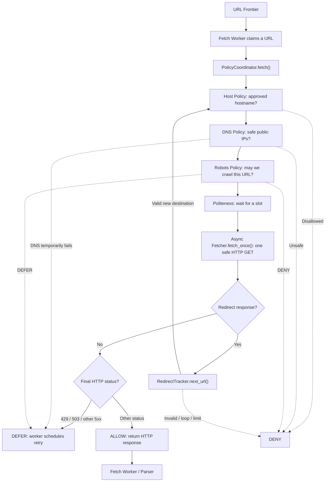
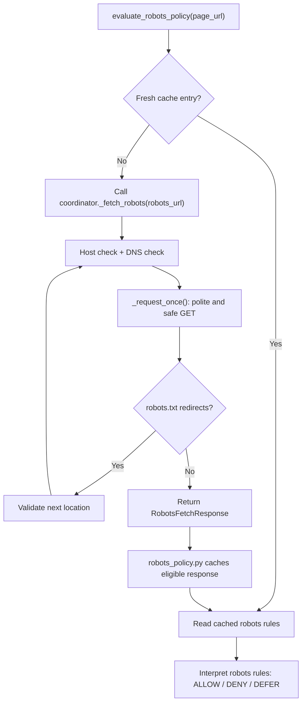

# Avengers assemble. Policy Coordinator. Final step of our crawler policy phase

---


---

We made **Host Policy**, **DNS Policy**, **Robots Policy**, **Politeness Policy**, and **Redirect Policy**.

Each of them does one job. But right now they are like five Avengers working separately. We need someone to bring the whole team together before our main hero, the **Async Fetcher**, starts downloading webpages.

That's what `policy_coordinator.py` does.

**The Policy Coordinator does not download webpages itself.** It connects all the policies, decides whether a request may proceed, and asks a separate Fetcher to make the actual HTTP request.

---

## 1. How the whole thing works



That diagram is the *main page-request flow*. If `robots.txt` is missing from our PostgreSQL cache, the coordinator also helps retrieve it securely. We'll get to that part.

**Remember:** The URL Frontier stores the work. The **Fetch Worker** claims the work and calls the coordinator. The coordinator handles the checks. The **Async Fetcher** opens the network connection.

---

## 2. Before Avengers fought Thanos, they fought over a contract

Before *Infinity War* and *Endgame*, the Avengers had their Civil War over the **Sokovia Accords**, a government-oversight agreement.

Now our main hero, **Async Fetcher**, also needs a contract before joining the team.

Not an actual legal contract. A **Python `Protocol`**.

```python
class OneHopFetcher(Protocol):
    async def fetch_once(
        self,
        *,
        url: str,
        approved_ips: Sequence[str],
        max_body_bytes: int,
        timeout_seconds: float,
        user_agent: str,
    ) -> OneHopResponse:
        ...
```

Basically, our coordinator is telling the future Fetcher:

> I don't care how you organize your internal code, but if you want to work with us, you need an async `fetch_once()` method. Accept these arguments, make **one safe GET request**, and return a `OneHopResponse`.

This is *not* a TCP or UDP protocol. `typing.Protocol` means a **programming interface / contract**.

### But what the hell is ONE HOP?

Imagine:

```text
https://example.com/old
       | HTTP 301
       v
https://example.com/new
       | HTTP 200
       v
Page content
```

We made **two HTTP requests** here. Each request is one *redirect hop* for the purposes of this design. `fetch_once()` only handles **one URL and one response**. It must NOT automatically follow the 301.

The coordinator checks the redirect and then authorizes a *new* one-hop fetch.

**Network-router hops are a completely different thing.** We're talking about application-level HTTP redirect steps.

---

## 3. What are `OneHopResponse` and `FetchResult`?

A contract tells us what the Fetcher must do. Now we need boxes to carry the result.

### `OneHopResponse` = One delivery receipt

```python
@dataclass(frozen=True, slots=True)
class OneHopResponse:
    status_code: int
    headers: Mapping[str, str]
    body: bytes = b""
```

Suppose our Fetcher requests a page and receives:

```http
HTTP/1.1 200 OK
Content-Type: text/html
```

With the downloaded HTML, it might return:

```python
OneHopResponse(
    status_code=200,
    headers={"content-type": "text/html"},
    body=b"<html>Hello Developer's Eye</html>",
)
```

Nothing magical. **This class does not fetch anything.** It just carries `status_code`, `headers`, and `body` back to the coordinator.

### `FetchResult` = The manager's final report

```python
@dataclass(frozen=True, slots=True)
class FetchResult:
    decision: RobotsDecision
    reason: str
    requested_url: str
    final_url: str
    redirect_chain: tuple[str, ...] = ()
    status_code: int | None = None
    headers: dict[str, str] = field(default_factory=dict)
    body: bytes = b""
    retry_after_seconds: float | None = None
```

This one is different. It is what the **coordinator returns to the Fetch Worker** after checking policies and possibly following redirects.

| Object | Who makes it? | Who receives it? | What is inside? |
| --- | --- | --- | --- |
| `OneHopResponse` | Async Fetcher | Policy Coordinator | One HTTP response |
| `FetchResult` | Policy Coordinator | Fetch Worker | Final decision, URL, redirect history, response or retry info |

`frozen=True` means we cannot casually change the object after constructing it. `slots=True` reduces instance overhead.

---

## 4. Assemble the team: `PolicyCoordinator.__init__()`

```python
coordinator = PolicyCoordinator(
    allowed_hosts=["example.com"],
    fetcher=actual_fetcher,
    politeness_manager=politeness_manager,
    max_redirects=5,
    max_body_bytes=2_000_000,
    timeout_seconds=15.0,
    user_agent="DevelopersEyeBot",
)
```

Here, `actual_fetcher` means an instance of the safe Fetcher **we still need to implement**. The snippet shows configuration, not a standalone runnable program.

| Setting | Why we need it |
| --- | --- |
| `allowed_hosts` | Approved hosts for this crawl / source |
| `fetcher` | The object that will actually perform HTTP GETs |
| `politeness_manager` | Share per-host concurrency and timing state |
| `max_redirects` | Reject chains exceeding 5 redirects |
| `max_body_bytes` | Cap page response bodies at 2,000,000 decoded bytes |
| `timeout_seconds` | Pass a 15-second timeout setting to the Fetcher |
| `user_agent` | Identify our crawler |

The constructor also rejects bad configurations: empty `allowed_hosts`, nonpositive body limit, invalid timeout, missing `fetch_once()` method, etc.

**Important:** The coordinator doesn't query our `source` table automatically. The worker or caller has to supply the appropriate `allowed_hosts` for the crawl target.

---

## 5. First question: where are we even going? `_approved_ips()`

Our Fetcher wants to download:

`https://example.com/docs/python`

But before that, the manager checks **Host + DNS** together:

```python
async def _approved_ips(self, url: str) -> list[str]:
    if not is_allowed_host(url, self.allowed_hosts):
        raise HostNotAllowedError(f"Host not allowed: {url}")

    host = urlsplit(url).hostname
    if host is None:
        raise HostNotAllowedError("URL has no hostname")

    return await resolve_safe_destination(host)
```

### Scenario 1: Approved website

1. Host Policy recognizes `example.com` as approved.
2. DNS Policy resolves it and rejects unsafe IP answers.
3. `_approved_ips()` returns the approved numeric IPs.
4. The coordinator passes those IPs to the Fetcher later.

### Scenario 2: Someone slips in `127.0.0.1`

Host Policy or DNS Policy blocks the destination. **No page request should be made.**

### Why give the Fetcher `approved_ips`?

Because checking DNS and then letting HTTPX **resolve the hostname a second time** could undermine the original safety check.

The Fetcher must use our already approved numeric IPs with the IP-pinned transport, while still using the correct hostname for HTTPS certificate checks and the `Host` header.

Think of it like getting an approved address from security and telling the driver: **go to that exact address, not some new address you looked up later**.

---

## 6. `_request_once()` = Get permission, then send ONE request

Now suppose the host and IP have passed.

```python
async def _request_once(
    self, url: str, approved_ips: Sequence[str], *, max_bytes: int
) -> OneHopResponse:
    async with self.politeness.polite_slot(url):
        response = await self.fetcher.fetch_once(
            url=url,
            approved_ips=tuple(approved_ips),
            max_body_bytes=max_bytes,
            timeout_seconds=self.timeout_seconds,
            user_agent=self.user_agent,
        )

        if len(response.body) > max_bytes:
            raise ResponseTooLargeError("Response exceeded body limit")

        await self.politeness.record_response(
            url,
            response.status_code,
            _header(response.headers, "Retry-After"),
        )
        return response
```

In plain English:

1. **Wait for Politeness:** Is a concurrency slot free? Has enough time passed? Are we in backoff?
2. **Call the Fetcher:** Make exactly one HTTP GET to an approved IP.
3. **Double-check size:** Reject a result bigger than our body limit.
4. **Record backoff:** If the response says `429` or `503`, update the politeness manager's pause deadline.
5. **Release the slot:** Exiting `async with` automatically gives the concurrency slot back.

### Our texting analogy again

Imagine we already checked that texting is allowed. `_request_once()` is the friend who says:

> Don't send another message yet. Two conversations are already open. Wait for your turn. Okay, now send **one** message, then tell me the reply.

**Technical correction:** The body size needs to be enforced **while the Fetcher streams the response**. Checking its length afterward is only an extra safety check, not a replacement.

And our 2-second delay is **between request starts**, not a forced break after every completed request.

---

## 7. Wait. What the hell is `_fetch_robots()` doing here AGAIN?

We already built `robots_policy.py`. So why is there another robots-related function inside the coordinator?

Because **checking the robots rules** and **downloading the robots file** are two different things.

In `robots_policy.py` we have:

```python
await evaluate_robots_policy(
    session,
    current_url,
    self._fetch_robots,
    user_agent=self.user_agent,
)
```

Our existing Robots Policy knows how to:

- Check `robots_cache` in PostgreSQL.
- Reuse the cached rules if they haven't expired.
- Interpret `Allow` and `Disallow` rules.
- Return `ALLOW`, `DENY`, or `DEFER`.

**But we deliberately didn't let that module open network connections.** Instead, it accepts a safe fetcher function for when the cache is missing or expired.

That function is `self._fetch_robots`.



### What `_fetch_robots()` actually does

It creates a `RedirectTracker` for `/robots.txt`, then for every robots-file hop it:

1. Checks host and DNS/IP safety.
2. Uses `_request_once()` to follow politeness and call the real one-hop Fetcher.
3. Validates any redirects without automatically following them.
4. Returns a `RobotsFetchResponse` containing the final status and robots text when applicable.
5. Converts expected retrieval failures into `RobotsFetchError` so the Robots Policy can defer.

It has a **special rule:** It does **not** check robots permissions before fetching `/robots.txt`. Otherwise we'd need to fetch `robots.txt` to get permission to fetch `robots.txt`, forever.

### Does it fetch robots.txt for every page?

**No.** A fresh PostgreSQL cache entry means `evaluate_robots_policy()` can use the saved rules. `_fetch_robots()` only gets called when a new retrieval is needed.

**Not duplicate policy. Not duplicate rules. Just a safe way to download the rulebook.**

---

## 8. Finally, `fetch()`: Nick Fury assembles everyone

This is the **main coordinator method** that the Fetch Worker calls.

Our simplified flow, matching the real implementation:

```python
# PSEUDOCODE, not a drop-in implementation
async def fetch(session, url):
    tracker = RedirectTracker(url, max_redirects=5)

    while True:
        current = tracker.current_url

        # First, Host + DNS policy.
        approved_ips = await _approved_ips(current)

        # Then, Robots Policy (cache or safe robots retrieval).
        robots = await evaluate_robots_policy(
            session,
            current,
            _fetch_robots,
        )
        if robots.decision != ALLOW:
            return FetchResult(...)

        # Politeness + exactly one network request.
        response = await _request_once(current, approved_ips)

        # Redirects must return to the top of the loop.
        if is_redirect(response.status_code):
            tracker.next_url(response.status_code, response.headers["Location"])
            continue

        # Classify the final response.
        return FetchResult(...)
```

### Why `while True`?

Because the same crawl can go through several redirects:

```text
example.com/old
    |
    | HTTP 301
    v
example.com/new
    |
    | HTTP 302
    v
docs.example.com/tutorial
    |
    | HTTP 200
    v
DONE
```

Every new destination goes through Host → DNS → Robots → Politeness **again**.

The `RedirectTracker` also rejects malformed destinations, loops, HTTPS-to-HTTP downgrades by default, and chains that exceed our configured redirect limit.

### Who tracks the redirect history?

`fetch()` starts a history list containing the original normalized URL and appends each accepted redirect destination.

The final `FetchResult` tells the Fetch Worker where we started, where we ended, and which URLs we followed.

---

## 9. What does the manager return? ALLOW, DENY, or DEFER

| Situation | Decision | What happens next? |
| --- | --- | --- |
| Safe request receives HTTP `200` | `ALLOW` | Worker can forward the HTML to the parser |
| HTTP `404` response | `ALLOW` | Worker sees page is missing; normally no content indexing |
| Host is not approved | `DENY` | Don't fetch |
| DNS resolves to unsafe IP | `DENY` | Don't fetch |
| Robots rule disallows page | `DENY` | Don't fetch |
| Invalid redirect / redirect loop | `DENY` | Stop chain |
| Response body exceeds limit | `DENY` | Don't process oversized response |
| DNS temporarily fails | `DEFER` | Scheduler should retry later |
| Robots temporarily unavailable | `DEFER` | Retry after the suggested delay |
| HTTP `429` or `503` | `DEFER` | Respect retry/backoff |
| Other HTTP `5xx` | `DEFER` | Retry later |

### Important trap: `ALLOW` does NOT mean HTTP 200

In this coordinator, `ALLOW` means a safely completed HTTP request reached a final response that isn't classified as a temporary server error. Even statuses like `404`, `401`, or `403` can be returned as `ALLOW` by the **page fetch** path.

The worker must inspect `status_code` before deciding to parse or index anything.

Also, `robots.txt` returning `401` or `403` has a **separate, stricter Robots Policy rule** that denies crawling in our implementation. Don't mix those two checks up.

---

## 10. `_header()`: A tiny helper we shouldn't forget

We look for headers such as `Location` and `Retry-After`.

But HTTP header names aren't case-sensitive. All of these mean the same thing:

```text
Retry-After: 60
retry-after: 60
RETRY-AFTER: 60
```

`_header(headers, name)` uses `.casefold()` to find the header regardless of capitalization. This also makes our mocked test responses work when headers are plain Python dictionaries.

---

## 11. Full scenario: from Frontier to final HTML

Imagine the worker receives:

`https://example.com/old-docs`

**Step 1.** The Fetch Worker calls `coordinator.fetch(session, url)`.

**Step 2.** The coordinator creates `RedirectTracker` and checks `example.com` against the allowed host list.

**Step 3.** DNS Policy returns approved public IPs.

**Step 4.** Robots Policy checks the cache. Let's imagine it is empty. `_fetch_robots()` retrieves `https://example.com/robots.txt` safely, and Robots Policy saves eligible results and checks whether `/old-docs` is allowed.

**Step 5.** Politeness waits until the host has an available concurrency slot and the required interval has passed.

**Step 6.** `_request_once()` calls `OneHopFetcher.fetch_once()` using the approved IPs. The response comes back `301 Location: /docs`.

**Step 7.** Redirect Policy resolves the new URL to `https://example.com/docs`, verifies the chain, and hands control back to the top of `fetch()`'s loop.

**Step 8.** Host and DNS checks run again. Robots Policy can reuse the same fresh robots cache, but evaluates the **new path**, `/docs`. Politeness applies again.

**Step 9.** The Fetcher receives HTTP `200` and returns the HTML as a `OneHopResponse`.

**Step 10.** The coordinator wraps everything in a `FetchResult(ALLOW, ...)` and returns it to the Fetch Worker.

Now the worker can send the body to the parser and record crawl results. **The coordinator does not save documents, release frontier leases, or commit the database session.**

---

## 12. Testing: did the Avengers actually work together?

Our existing refactored coordinator pytest suite passed **38 local tests** in the test setup. The suite uses a **fake `OneHopFetcher`**, fake DNS responses, and mocked robots decisions. No real websites or PostgreSQL connections are used in those unit tests.

The checks include:

- Allowed host + safe IP passed to the fake Fetcher.
- Invalid / unapproved URLs stopped before network requests.
- Unsafe IPs denied; DNS failures deferred.
- Robots `DENY` and `DEFER` prevent page fetches.
- Redirects recheck host, DNS, and robots permissions.
- Redirect loops, missing `Location`, HTTPS downgrade, and hop limit rejected.
- HTTP `429`/`503` deferral and backoff handling.
- Oversized response rejection; temporary network failures deferred.
- Cancelled fetches release politeness slots.
- Separate hostnames get separate politeness state.
- Special safe retrieval of `robots.txt` without checking itself recursively.

To run your repo's tests from the `crawler/` directory:

```bash
poetry run pytest tests/test_policy_coordinator.py -v
```

**What is NOT verified yet:** live IP-pinned HTTP requests, TLS certificate verification, streaming limits in the real Fetcher, actual PostgreSQL caching/transactions, and full Fetch Worker + scheduler integration.

---

## 13. Now what remains?

Policy Coordinator is our team manager, but **we still haven't hired the person who actually makes the HTTP request**.

Next: `fetcher.py`.

Its `fetch_once()` implementation must:

1. Receive **one URL + approved IPs** from the coordinator.
2. Use HTTPX through our **IP-pinned safe transport**.
3. Keep HTTPS hostname verification and the correct `Host` header.
4. Disable automatic redirects and untrusted proxies.
5. Apply request timeout and response-size limits **during** streaming.
6. Close the response before returning `OneHopResponse`.
7. Make exactly one request. No unchecked retries or second DNS lookups.

After that, we can wire the real Fetcher into the coordinator and run integration tests.

**The difference I need to remember:**

```text
URL Frontier      = Which URLs are waiting?
Fetch Worker      = Who is processing this URL?
Policy Coordinator= Is this request allowed, and when?
Async Fetcher     = Actually make the HTTP GET.
OneHopResponse    = The Fetcher's single-request receipt.
FetchResult       = The coordinator's final report.
Parser            = Turn downloaded bytes into useful content.
```

Avengers assembled. Now the Fetcher can enter the battlefield.
