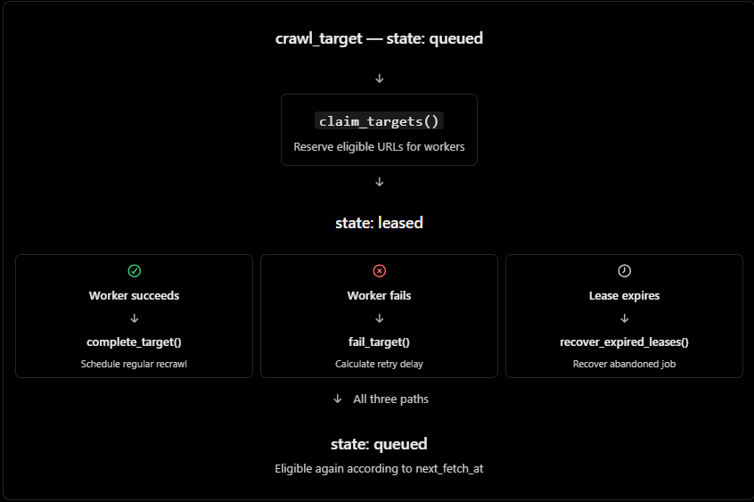

# Initially crawl_target status is queued.



- now we want to crawl the target. so we pass it to `claim_target()`
- claim target checks priority time id and set the '**`status = leased`**'
   - -> we used **`FOR UPDATE SKIP LOCKED`** here. so that if worker A claims the target A no worker can touch it.
   - -> after changing to lease it gets **5min reservation**. worker A now work with this for 5min time limit.

---

- suppose worker A took longer than 5min to work with target A. Now if the time expire but the job is not done postgres will keep it marked as leased always.
- **`recover_expired_leases()`** if lease_until expires it change the **`state=queued`** . this function will be called periodically

---

- **`complete_target()`**
- now if worker A complete target A within the time limit , when time expires it is sent back to **`state=queued`** with **`lease_until=None`** and a next fetch schedule

---

### `calculate_retry_delay()`

- this is a helping function to cap the failure count and delay of the process.
- it have a simple formula

```math
\text{delay} = \min\left(\text{base} \times 2^{(\text{failure\_count} - 1)},\ \text{max}\right)
```

with this formula it counts delay. **[TODO: add `full jitter` for scalability]**

**summary in one line:** for each retry delay will be increased within cap

---

### Summary

- **`claim_target()`**- start work
- **`recover_expired_leases()`** - handle if worker cant complete within deadline
- **`complete_target()`** - handle if worker completes within deadline
- **`fail_target()`** - handles if worker fails to do the work.

- if it fails multiple time **`failure_count`** counts the time. and it retries follwing **`calculate_retry_delay()`** formula. for each failure retry delay keep incresing with **cap of 1hour**.