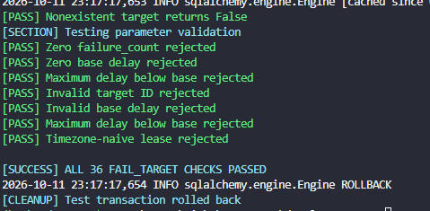

# Developers Eye — Scheduler Tests


- ---

- ---
## 1. `test_repository.py`

Tests the two core scheduler functions:

**`claim_targets()`**
- Finds eligible queued targets.
- Prioritizes by `priority`, `next_fetch_at`, and `id`.
- Uses `FOR UPDATE SKIP LOCKED` to avoid conflicting claims.
- Changes `state` from `queued` to `leased`.

**`recover_expired_leases()`**
- Finds targets whose leases have expired.
- Changes `state` from `leased` to `queued`.
- Clears `lease_until`.
- Allows due targets to be claimed again.

**Purpose:** Verify that jobs are assigned correctly and abandoned jobs can be recovered.

---

## 2. `test_complete_target.py`

Tests `complete_target()` when a worker successfully finishes crawling.

**Expected database changes:**

| Field | Result |
|---|---|
| `state` | `queued` |
| `lease_until` | `NULL` |
| `last_fetched_at` | `NOW()` |
| `next_fetch_at` | `NOW() + crawl_interval_seconds` |
| `failure_count` | `0` |

**Additional checks:**
- Successful completion returns `True`.
- Duplicate completion is rejected.
- Expired or mismatched leases are rejected.
- Invalid parameters raise `ValueError`.

**Purpose:** Verify that successfully crawled URLs are released and scheduled for their next regular crawl.

---

## 3. `test_fail_target.py`

Tests two functions:

**`calculate_retry_delay()`**

Calculates capped exponential backoff:

$$
\text{delay} = \min(\text{base} \times 2^{(\text{failure\_count}-1)}, \text{max})
$$

Default configuration:
- Base delay: **60 seconds**
- Maximum delay: **3,600 seconds (1 hour)**

**`fail_target()`**

When a worker encounters an error:
- Validates its lease.
- Increments `failure_count`.
- Calculates the retry delay.
- Changes `state` from `leased` to `queued`.
- Clears `lease_until`.
- Schedules `next_fetch_at` using the retry delay.

**Additional checks:**
- Delay increases after consecutive failures.
- Delay never exceeds the configured cap.
- Duplicate failure reports are rejected.
- Expired and mismatched leases are rejected.
- Invalid parameters raise `ValueError`.

**Purpose:** Verify that failed URLs can be retried safely without overwhelming the target server.

---

## 4. Running the tests

From the project root:

```powershell
python -m crawler.schedular.tests.test_repository
python -m crawler.schedular.tests.test_complete_target
python -m crawler.schedular.tests.test_fail_target
```

Colorama provides colored terminal output:
- **Green:** PASS
- **Red:** FAIL
- **Cyan:** Progress and success messages

## 5. Database safety

These are PostgreSQL integration tests.

They create temporary database records, execute real SQL queries and updates, and roll back the test transaction afterward.

**Important:** Run them on a development or dedicated test database, not production.

## 6. Other files

- `__pycache__/` — Automatically generated Python bytecode cache.
- `test1_report.md` — Existing Markdown report file, not an executable Python test.

## 7. Remaining work

- [ ] Verify `test_fail_target.py` passes.
- [ ] Test concurrent claims using separate database sessions.
- [ ] Integrate `CrawlAttempt` with the fetch workers.
- [ ] Add robots.txt, host validation, DNS/IP safety, and redirect validation.
- [ ] Test real HTTP fetching with HTTPX.

**Summary:** These tests verify the scheduler's job claiming, lease recovery, successful completion, and failure retry logic before the crawler starts processing real webpages.