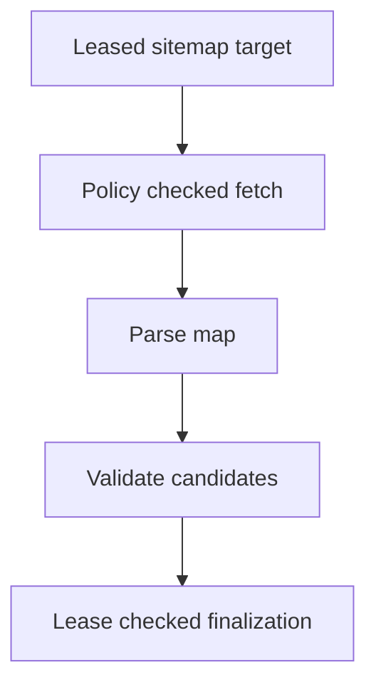

# Sitemap Discovery and Worker Jobs

**Files:** `seed/discovery.py`, `parser/sitemap.py`, `worker/jobs/jobs.py`, `worker/jobs/utility.py`.

## 1. We can parse a sitemap. Who finds it?

So the XML parser works, but a parser cannot guess which URL to download. We need to put the first sitemap into the same PostgreSQL frontier that already holds our HTML pages.

There are three ways to find it: a source's configured URLs, its origin's `/sitemap.xml`, and `Sitemap:` lines in robots.txt. None of these gives a URL permission to bypass our policies.

## 2. Start with a source

Suppose our source starts at `https://example.com/docs`:

```json
{
  "max_depth": 3,
  "max_pages": 10000,
  "allowed_path_prefixes": ["/docs"],
  "discover_sitemaps": true,
  "sitemap_urls": ["https://example.com/documentation-map.xml"]
}
```

These are fields inside `source.config`, not a separate configuration file. Add them to a source's JSON registry definition before registering that source, or update the existing source through the registry. Startup registration preserves existing slugs instead of overwriting their configuration.

`build_initial_targets()` produces the page seed, the configured sitemap and the `/sitemap.xml` candidate. URLs on hosts outside `allowed_hosts` are excluded. Configured sitemap URLs must be absolute HTTP(S) URLs; there can be at most 100.

`discover_sitemaps: false` disables automatic fallback and robots declarations. Explicit `sitemap_urls` still work because we supplied those deliberately.

## 3. Why is `/sitemap.xml` allowed outside `/docs`?

Our content scope is `/docs`, but a website usually puts its map at the origin root.

The map can be outside the content path scope. Its page URLs cannot. Otherwise a map could quietly expand a documentation crawl into `/account` or `/private`.

Every map request still uses the source's allowed hosts, safe DNS/IP validation, checked redirects, robots.txt and shared politeness manager.

## 4. Reuse the robots request

The policy coordinator already retrieves or reads cached robots.txt. We extract at most 100 distinct absolute sitemap declarations from that same content:

```text
User-agent: *
Disallow: /private
Sitemap: https://example.com/docs-map.xml
```

`RobotsPolicyResult.sitemap_urls` carries the declarations to `FetchResult.sitemap_urls`. The worker converts them into sitemap candidates after a successful parse. We do not open a second unchecked HTTP client to fetch them.

A declaration on another host is filtered unless that host is also in `allowed_hosts`.

## 5. What does the worker do differently?

The fetch stage is shared. The parser is selected by target kind:

| Target kind | Parser output |
|---|---|
| `page` | HTML document and hyperlinks |
| `sitemap` with `urlset` | Page candidates, no documents |
| `sitemap` with `sitemapindex` | More sitemap candidates, no documents |

The map itself never becomes a searchable document. Its parsed result has an empty `documents` tuple.

## 6. What happens to depth?

Depth has two meanings, depending on the target kind.

For HTML, following a hyperlink adds one. For sitemap traversal, following a child sitemap adds one. Both are bounded by `max_depth`.

A page found directly in a sitemap starts at page depth zero. A sitemap index is discovery infrastructure; walking through it should not consume that page's HTML link budget.

A robots declaration starts a separate sitemap traversal at depth zero. All resulting rows also count toward the source's existing `max_pages` frontier budget.

## 7. Cycles, repeated URLs and large maps

Imagine map A links to B and B links to A. The source-and-normalized-URL uniqueness constraint prevents another copy of A. Depth and source budgets provide additional bounds.

A parser may return up to 50,000 entries, while one job's existing `max_links` limit defaults to 1,000 candidates. This implementation processes a bounded prefix; it does not promise to import every URL in a larger map. The final enqueue can accept fewer rows if the source budget is already used.

Failed or malformed maps go through the ordinary retry path. A 404 or 410 uses the normal recrawl schedule. A missing fallback sitemap does not stop the page seed from being crawled.

## 8. Finish in one transaction



The existing finalizer commits candidate URLs, the target transition and the finished attempt together. If the lease has expired or another worker owns it, the result is discarded.

HTTP `X-Robots-Tag: nofollow` also stops sitemap link enqueueing. Parse, discovery and finalization results use the dashboard's existing attempt events.

## 9. Run it

The worker's startup source sync registers new JSON sources and queues eligible seeds. From the crawler directory:

```powershell
poetry run python -m crawler.worker.runner --once --batch-size 5 --concurrency 2
```

This is a real crawl and performs database writes. For an isolated test from the repository root:

```powershell
.\crawler\.venv\Scripts\python.exe -m pytest crawler/tests/test_sitemap_discovery.py -q
```

Those tests check seed construction, robots declarations, host/path filtering, nested depth and the worker's policy-to-finalization dispatch without using a live database.
