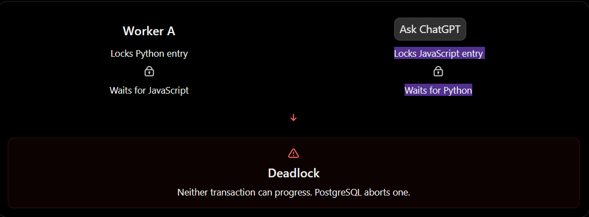
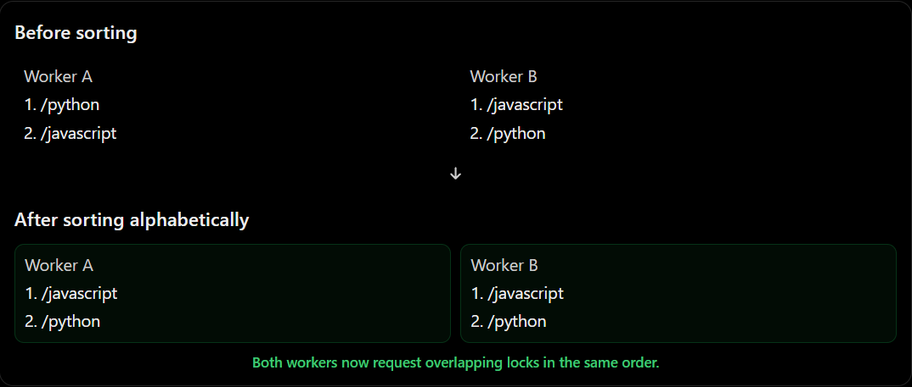
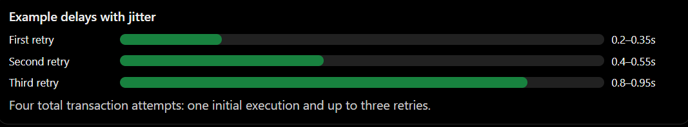

# Fixing PostgreSQL Deadlocks in Developer's Eye

**Files involved:**
- `crawler/src/crawler/frontier/repository.py`
- `crawler/src/crawler/worker/jobs/jobs.py`
- `crawler/src/crawler/worker/jobs/utility.py`

---

## 1. The problem: Deadlock

During our multi-worker crawler stress test, we encountered PostgreSQL errors:

```text
OperationalError: (psycopg.errors.DeadlockDetected)
deadlock detected

CONTEXT:
while inserting index tuple in relation "crawl_target"
```

Our crawler was successfully fetching and processing documents. However, some workers failed while saving results and discovered URLs to PostgreSQL.

### What is a deadlock?

Imagine two people, A and B, trying to borrow two books from a library.

- Person A grabs the Python book.
- Person B grabs the JavaScript book.
- A now wants JavaScript, but B is holding it.
- B now wants Python, but A is holding it.

Neither can continue because each is waiting for the other.



The same problem can happen in databases when transactions acquire conflicting locks in different orders.

For example:

```text
Worker A discovers:         Worker B discovers:

1. /python                 1. /javascript
2. /javascript             2. /python
```

A possible sequence:

```text
Worker A                       Worker B
   |                              |
Locks Python entry           Locks JavaScript entry
   |                              |
Wants JavaScript             Wants Python
   |                              |
Waits for B                  Waits for A
   |                              |
   +---------- DEADLOCK ----------+
```

PostgreSQL detects this circular dependency and aborts one of the transactions so the other can continue.

**Important:** This is an example of how deadlocks happen, not a confirmed reconstruction of the exact PostgreSQL lock cycle from our logs.

### Why did it happen in Developer's Eye?

Our crawler supports multiple workers.

Each worker:

1. Claims URLs from PostgreSQL.
2. Fetches HTML.
3. Parses and processes documents.
4. Saves documents.
5. Inserts newly discovered links into `crawl_target`.

Multiple workers can discover overlapping URLs simultaneously.

Our `enqueue_targets()` function originally inserted targets in their discovery order, which could differ between workers.

Even though we use PostgreSQL's `ON CONFLICT DO NOTHING` to avoid duplicate entries, conflicting concurrent inserts can still cause deadlocks.

We need two fixes:

- **Deterministic ordering:** Reduce the likelihood of deadlocks.
- **Transaction retry:** Recover safely when PostgreSQL still detects one.

---

## 2. Fix #1: Deterministic ordering

**File:** `crawler/src/crawler/frontier/repository.py`

### What does deterministic mean?

Deterministic means that the same input produces the same result under the same rules.

In our case, we want workers to attempt inserting URLs in a consistent order, regardless of the order in which they discovered those URLs.



### Before

Our code originally did:

```python
inserted_count = 0

for start in range(0, len(targets), BATCH_SIZE):
    batch = targets[start:start + BATCH_SIZE]
```

The targets were inserted in their incoming order.

For example:

```text
Worker A: C, A, B
Worker B: B, C, A
```

The workers might encounter conflicting database entries in different orders.

### After

We first deduplicate targets and then sort them.

```python
unique_targets = {}

for target in targets:
    key = (target.source_id, target.normalized_url)
    unique_targets.setdefault(key, target)

ordered_targets = [
    unique_targets[key]
    for key in sorted(unique_targets)
]
```

Now both workers use the same ordering rule:

```text
Worker A: A, B, C
Worker B: A, B, C
```

The actual lists may contain different URLs, but overlapping URLs are ordered consistently.

### Understanding the code

**Step 1: Create an empty dictionary**

```python
unique_targets = {}
```

We need to remove duplicate targets before inserting them.

**Step 2: Create a unique key**

```python
key = (target.source_id, target.normalized_url)
```

Our database identifies unique crawl targets using:

```text
(source_id, normalized_url)
```

Why not use only `normalized_url`?

Because the same URL may legitimately belong to multiple registered sources.

**Step 3: Deduplicate**

```python
unique_targets.setdefault(key, target)
```

`setdefault()` inserts the target only if its key does not already exist.

If the key already exists, the original value is preserved.

This also preserves the first target's `discovered_from_id`.

**Step 4: Sort**

```python
ordered_targets = [
    unique_targets[key]
    for key in sorted(unique_targets)
]
```

`sorted()` returns the keys in a consistent ascending order.

Since our keys are tuples, Python compares `source_id` first and then `normalized_url`.

**Step 5: Insert the ordered targets**

```python
for start in range(0, len(ordered_targets), BATCH_SIZE):
    batch = ordered_targets[start:start + BATCH_SIZE]
```

We must sort the complete collection before batching.

Otherwise, separate batches could still be processed in inconsistent orders.

### Why this helps

When transactions acquire conflicting locks in a consistent order, there are fewer opportunities for circular waiting.

However, deterministic ordering does **not guarantee that deadlocks cannot happen**.

Our database transaction also modifies the current crawl target, updates documents, acquires advisory locks and writes crawl attempts.

These operations can create additional lock dependencies.

So we need another layer of protection.

---

## 3. Fix #2: Retry database transactions after deadlocks

**File:** `crawler/src/crawler/worker/jobs/jobs.py`

### Why do we need retries?

Imagine Worker A successfully downloads a webpage.

It extracts:

```text
Title: Python Documentation
Body: Python programming language...
Links: 150
```

Now it tries to save the document and the discovered URLs.

But PostgreSQL detects a deadlock.

The transaction is aborted.

Does that mean we need to download the webpage again?

**No.**

The fetched and processed content is still available in Python memory.

We only need to retry the database transaction.

### What is a transaction?

A database transaction groups multiple operations into one atomic unit.

For example:

```text
BEGIN TRANSACTION

1. Update crawl target
2. Insert/update document
3. Insert discovered URLs
4. Update crawl attempt
5. Mark attempt finished

COMMIT
```

If the transaction succeeds, PostgreSQL commits its changes.

If it fails:

```text
ROLLBACK
```

The transaction's changes are undone.

This is important because we do not want a partially completed crawl operation.

### Our approach

```text
Fetch → Parse → Process
                  |
                  v
           Finalize transaction
                  |
             +----+----+
             |         |
           Success   Deadlock
             |         |
           Commit    Rollback
                       |
                    Wait
                       |
                 New transaction
                       |
                     Retry
```

### Implementing retries

First, add the imports:

```python
import asyncio
import random

from collections.abc import Awaitable, Callable
from sqlalchemy.exc import DBAPIError
```

Then create a retry helper in `jobs.py`:

```python
async def retry_deadlocked_finalization(
    operation: Callable[[], Awaitable[JobResult]],
    *,
    max_attempts: int = 4,
) -> JobResult:
    if max_attempts < 1:
        raise ValueError("max_attempts must be positive")

    for attempt in range(1, max_attempts + 1):
        try:
            return await operation()

        except DBAPIError as exc:
            sqlstate = getattr(exc.orig, "sqlstate", None)

            if sqlstate != "40P01":
                raise

            if attempt == max_attempts:
                logger.error(
                    "Finalization deadlock persisted after %d attempts",
                    max_attempts,
                )
                raise

            delay = min(
                0.2 * (2 ** (attempt - 1)),
                2.0,
            )

            delay += random.uniform(0.0, 0.15)

            logger.warning(
                "Database deadlock, retry %d/%d in %.2fs",
                attempt + 1,
                max_attempts,
                delay,
            )

            await asyncio.sleep(delay)

    raise RuntimeError("Unreachable retry state")
```

### Understanding the implementation

**1. `DBAPIError`**

SQLAlchemy uses database drivers to communicate with PostgreSQL.

When the database reports an error, SQLAlchemy can wrap it in a `DBAPIError`.

But not every database error is retryable.

For example:

```text
Table does not exist       → Code/schema problem
Invalid SQL               → Code problem
Deadlock                  → Potentially transient concurrency problem
```

We should only retry errors that may succeed on another attempt.

**2. SQLSTATE `40P01`**

PostgreSQL categorizes errors using SQLSTATE codes.

```python
sqlstate = getattr(exc.orig, "sqlstate", None)
```

In our case:

```text
40P01 = deadlock_detected
```

So:

```python
if sqlstate != "40P01":
    raise
```

This ensures unrelated database errors are not silently retried.

**3. Maximum attempts**

```python
max_attempts = 4
```

This means:

```text
Attempt 1 → Initial transaction
Attempt 2 → First retry
Attempt 3 → Second retry
Attempt 4 → Third retry
```

If all four attempts fail, the error is propagated.

Unlimited immediate retries could waste resources and worsen database contention.

---

## 4. Exponential backoff and jitter



### What is exponential backoff?

Instead of immediately repeating a failed operation, we wait.

Each consecutive retry increases the waiting time.

Our base formula is:

```python
delay = 0.2 * (2 ** (attempt - 1))
```

With our four-attempt limit:

| Retry | Base delay |
|---|---|
| First | 0.2 seconds |
| Second | 0.4 seconds |
| Third | 0.8 seconds |

### What is jitter?

Jitter means adding a small amount of randomness to the delay.

```python
delay += random.uniform(0.0, 0.15)
```

Why?

Imagine four workers experience a deadlock at the same moment.

Without jitter:

```text
Worker A → Wait 200ms
Worker B → Wait 200ms
Worker C → Wait 200ms
Worker D → Wait 200ms
```

All four wake up simultaneously and may compete for the same database locks again.

With jitter:

```text
Worker A → Wait 221ms
Worker B → Wait 278ms
Worker C → Wait 314ms
Worker D → Wait 239ms
```

Now their retries are spread across slightly different moments.

This reduces synchronized contention.

### Retry timing

| Retry | Possible delay |
|---|---|
| First | 0.20–0.35 seconds |
| Second | 0.40–0.55 seconds |
| Third | 0.80–0.95 seconds |

These are deliberately short because a database deadlock is different from a website returning HTTP 429.

For HTTP errors, our crawler can wait minutes.

For transient PostgreSQL deadlocks, waiting milliseconds may be sufficient.

**Important distinction:** Database transaction backoff and HTTP crawl retry backoff are separate mechanisms.

---

## 5. Connecting the retry helper to our worker

Our worker calls `_finalize()` after fetching, parsing and processing a page.

We should retry that function, not restart the whole crawl.

In `process_job()`, define:

```python
async def finalize_once() -> JobResult:
    return await _finalize(
        session_factory=session_factory,
        target_id=target_id,
        source_id=source_id,
        expected_lease_until=lease,
        attempt_id=attempt_id,
        action=action,
        outcome=outcome,
        message=message,
        http_status=http_status,
        body_bytes=body_bytes,
        retry_after_seconds=retry_after,
        interval_seconds=interval_seconds,
        parsed=parsed,
        processed=processed,
        targets=new_targets,
        elapsed=time.perf_counter() - started,
        measurements=measurements,
    )
```

Then call:

```python
try:
    return await retry_deadlocked_finalization(
        finalize_once
    )

except Exception as exc:
    measurements["error_category"] = "persistence"

    await checkpoint(
        session_factory,
        attempt_id,
        "STORE",
        "failed",
        {"error": f"{type(exc).__name__}: {exc}"[:1000]},
        measurements,
    )

    raise
```

### Why use `finalize_once()`?

We pass a callable that creates a new coroutine every time.

```python
retry_deadlocked_finalization(finalize_once)
```

Each execution of `_finalize()` opens a new SQLAlchemy session and transaction.

When the previous transaction fails, its context manager rolls it back.

The retry starts fresh.

If we reused the failed transaction or tried to await the same coroutine again, the implementation would not work correctly.

### Why is retrying `_finalize()` safe?

Our `_finalize()` function groups related database changes inside one transaction.

A deadlock aborts the transaction, so its uncommitted changes are rolled back.

We can then attempt the full set of operations again.

There are still important requirements:

- Database writes must be transactional.
- Operations should be idempotent where necessary.
- The retry must verify that the original crawl lease is still valid.
- External side effects must not be repeated inside the retry.

Our current `_finalize()` already includes lease validation.

This protects against a worker saving results after another worker has acquired the target's expired lease.

---

## 6. Fix #3: Recover after all retries fail

**Status: Still needs implementation and verification.**

Retrying deadlocks is not enough.

What happens if all four attempts fail?

```text
Worker fetches document
       |
       v
Persistence attempt 1 → Deadlock
Persistence attempt 2 → Deadlock
Persistence attempt 3 → Deadlock
Persistence attempt 4 → Deadlock
       |
       v
Finalization fails
```

Our worker currently records a persistence error and propagates the exception.

The crawler's lease-recovery mechanism can later requeue the target once its lease expires.

However, the associated `crawl_attempt` may remain unfinished.

During our stress test, we observed hundreds of persistence failures and unfinished attempts.

### Desired recovery behavior

When finalization exhausts retries:

1. Open a separate database transaction.
2. Record the original attempt as failed.
3. Store the persistence error.
4. Check whether the original lease is still owned by this worker.
5. If valid, requeue the target using the scheduler's failure-backoff logic.
6. If ownership is lost, do not overwrite another worker's state.

We must not blindly clear leases or mark every unfinished attempt as failed.

Some unfinished attempts may still be actively processing.

### What if the database itself is unavailable?

The recovery transaction could also fail.

In that situation, lease-expiration recovery remains the fallback for reclaiming the target.

A separate reconciliation process may be needed to close abandoned attempt records.

This recovery logic should be implemented and tested before considering the crawler production-ready.

---

## 7. How do we test these fixes?

### Test A: Single-worker baseline

Run:

```powershell
poetry run python -m crawler.worker.runner --once --batch-size 1 --concurrency 1 --log-level INFO
```

Our initial test already produced:

```text
CLAIM recovered=0 claimed=1
DONE outcome=success status=200 docs=1 links=1
BATCH succeeded=1 failed=0
```

This confirms that normal single-worker execution succeeded in that test.

It does not prove multi-worker reliability.

### Test B: Deterministic ordering

Provide intentionally unordered and duplicate targets to `enqueue_targets()`.

Verify that:

- Duplicate `(source_id, normalized_url)` pairs are removed.
- The insert payload is consistently ordered.
- The number of inserted targets is correct.

Use a disposable test database or mock the database execution.

### Test C: Deadlock recovery

Simulate PostgreSQL SQLSTATE `40P01`.

Expected behavior:

```text
Attempt 1 → Deadlock
Rollback
Wait
Attempt 2 → Success
Commit
```

The operation should succeed without another HTTP fetch.

### Test D: Retry exhaustion

Simulate four consecutive deadlocks.

Expected behavior:

```text
Attempt 1 → Deadlock
Attempt 2 → Deadlock
Attempt 3 → Deadlock
Attempt 4 → Deadlock

Result → Error propagated
```

After implementing failure recovery, verify the attempt and frontier reach consistent states.

### Test E: Multi-worker concurrency

Run multiple workers against the same disposable PostgreSQL frontier.

Check:

- No duplicate simultaneous claims of an active lease.
- No lost documents or discovered URLs.
- Deadlocked transactions can recover.
- Abandoned leases can be reclaimed.
- Finished attempts have terminal outcomes.
- A stale worker cannot overwrite newer results.

For testing concurrency on real sites, remember that our current politeness manager is local to each worker process. Multiple workers do not yet share a host-wide rate limit.

---

## 8. What we learned

Before this test, our crawler worked with one worker.

When we increased concurrency, it exposed problems that were not obvious under light load.

The stress test revealed that successful HTTP requests do not automatically mean successful crawl jobs.

Our pipeline has multiple stages:

```text
FETCH
  ↓
PARSE
  ↓
PROCESS
  ↓
PERSIST
  ↓
FINALIZE
```

A failure at any stage can prevent successful completion.

From this debugging session, we learned:

1. **Deadlocks:** Concurrent database transactions can block each other in circular dependencies.
2. **Deterministic ordering:** Consistent acquisition order can reduce deadlock risk.
3. **Transactions:** Related database writes should succeed or roll back together.
4. **Retries:** Transient database errors can be retried using a fresh transaction.
5. **Exponential backoff:** Increasing delays reduce immediate repeated contention.
6. **Jitter:** Randomized delays prevent synchronized retry attempts.
7. **Lease ownership:** A worker must verify that it still owns a target before persisting results.
8. **Failure recovery:** A failed worker operation must not leave crawler state permanently inconsistent.

### Final engineering principle

**Concurrency exposes problems that sequential execution can hide.**

A system that works with one worker is not automatically reliable with ten.

For Developer's Eye, the goal is not simply to crawl websites faster. It is to ensure that increasing the number of workers does not compromise data integrity, correctness or recoverability.

---

## Implementation status

| Improvement | Status |
|---|---|
| Single-worker baseline | Passed |
| Deterministic URL ordering | Code change documented; test pending |
| PostgreSQL deadlock transaction retry | Code change documented; test pending |
| Retry exhaustion handling | Existing error propagation; recovery incomplete |
| Unfinished-attempt reconciliation | Pending |
| Multi-worker integration test | Pending |
| Shared host-level politeness | Pending |

**Next:** Implement the transaction-retry changes, add tests for SQLSTATE `40P01`, and then address failure recovery before another large crawl.
