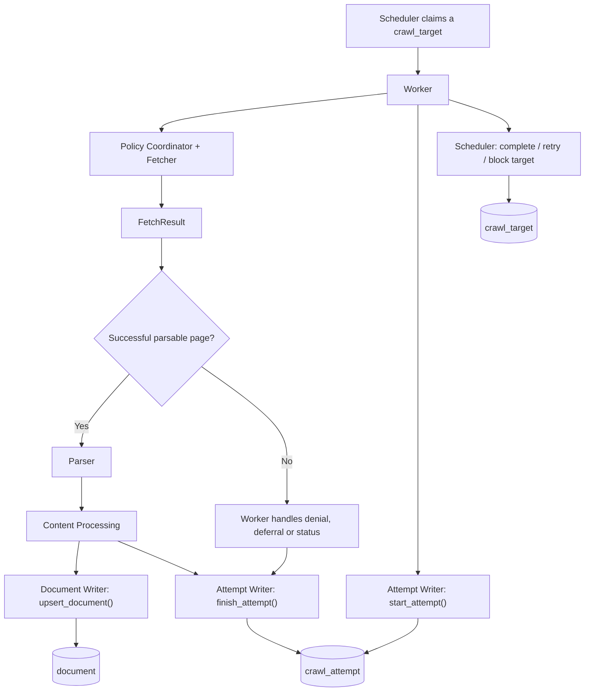

# Developer's Eye: Database Writer

---


---

## What is the Writer?

So far we built Source Registry, Seed Discovery, Scheduler, URL Frontier, Policy Coordinator, Fetcher, Parser and Content Processing.

The Fetcher downloads the webpage. The Parser extracts the useful information. Content Processing cleans the document, classifies it and creates a content hash.

BUT THERE IS A PROBLEM.

All these modules can return data, but none of them are responsible for saving our final crawl result into PostgreSQL.

Imagine our crawler successfully fetched a Python documentation page, extracted the entire tutorial and discovered 30 more links. Then the program ends. If we never saved the results, the next time we start the crawler we have no stored document to search.

That's why we are creating a **Database Writer**.

**Worker decides what needs to happen. Writer decides how the result is saved.**

The Writer is not another crawler. It won't fetch URLs, check robots.txt, parse HTML or schedule retries. It only executes database statements using a session provided by the Worker.

## Complete flow



**Important:** This shows the integration we are building. The Writer doesn't automatically call the other modules. The Worker still needs to connect them.

## Our Writer folder

```text
crawler/src/crawler/
│
├── parser/
├── processing.py
│
└── writer/
    ├── __init__.py
    ├── attempts.py      # Store history of crawl attempts
    └── documents.py     # Insert/update processed documents
```

Why two files? Because **crawling a URL** and **saving a document** are not the same thing.

A URL might fail, be blocked by policy, return 404, return 304 or successfully produce a document. We still want to record the attempt even when we have no document to save.

---

## 1. `attempts.py` — What happened when we tried to crawl?

Suppose we scheduled this URL:

`https://docs.python.org/3/tutorial/`

Our Worker claims it from `crawl_target` and begins processing.

We want to know when the attempt started, which target it belongs to, whether the HTTP request succeeded, and what failed if something went wrong.

That's why we already created the `crawl_attempt` table.

```text
crawl_attempt
---------------------------------
id
crawl_target_id
started_at
finished_at
http_status
outcome
error_message
bytes_received
```

Our new `attempts.py` contains two functions.

### `start_attempt()`

```python
async def start_attempt(
    session: AsyncSession,
    target_id: int,
) -> int:
    ...
```

This function uses SQLAlchemy `INSERT` and PostgreSQL `RETURNING`.

```python
statement = (
    insert(CrawlAttempt)
    .values(crawl_target_id=target_id)
    .returning(CrawlAttempt.id)
)
```

Step by step:

1. Worker gives us the database session and crawl target ID.
2. We validate the target ID.
3. We insert a `crawl_attempt` row. PostgreSQL sets `started_at` using its default.
4. We get back the generated attempt ID.
5. Worker commits that short transaction **before network I/O**.

Example unfinished row:

```text
id: 42
crawl_target_id: 10
started_at: 2026-10-19 15:00:00+00
finished_at: NULL
http_status: NULL
outcome: NULL
```

Why do this before fetching?

Imagine the Worker crashes while downloading a page. If the start transaction was committed, the database still shows that an attempt started but never finished. We can investigate it later.

### `finish_attempt()`

```python
async def finish_attempt(
    session: AsyncSession,
    attempt_id: int,
    outcome: str,
    *,
    http_status: int | None = None,
    bytes_received: int | None = None,
    error_message: str | None = None,
) -> bool:
    ...
```

After the Worker finishes handling the URL, it calls this function to update the existing row.

It uses `UPDATE ... RETURNING`, not another INSERT.

```python
update(CrawlAttempt).where(
    CrawlAttempt.id == attempt_id,
    CrawlAttempt.finished_at.is_(None),
)
```

Notice `finished_at IS NULL`.

That means we don't accidentally finish the same attempt twice. If the row doesn't exist or was already finished, the function returns `False`.

We accept these outcomes because they match our database constraint:

| Outcome | Meaning |
|---|---|
| `success` | Worker classified the attempt as successful |
| `failed` | The attempt failed; a retry might be needed |
| `blocked` | Policy/security prevented crawling |
| `not_modified` | HTTP 304: remote content was not modified |

**The Writer doesn't choose the outcome.** The Worker interprets `FetchResult` and decides which value to save.

Also, `bytes_received` should describe the response-body bytes that our Fetcher actually returned or measured. `len(FetchResult.body)` is not necessarily the complete network traffic or response-header size.

---

## 2. `documents.py` — Save the useful content

The second file saves the `ProcessedDocument` created by Content Processing.

We already have a PostgreSQL `document` table, including:

```text
document
---------------------------------
id
source_id
last_crawl_target_id
canonical_url       UNIQUE
document_type
title
description
body
author
metadata           JSONB
content_hash
published_at
last_seen_at
updated_at
```

Our function:

```python
async def upsert_document(
    session: AsyncSession,
    document: ProcessedDocument,
    *,
    source_id: int,
    crawl_target_id: int,
) -> int:
    ...
```

It receives an already-processed document plus IDs of the approved source and the crawl target.

No HTML parsing here. No metadata extraction. We already did those steps.

### What is UPSERT?

UPSERT is basically **INSERT + UPDATE when a conflict happens**.

Imagine we crawl this page for the first time:

`https://docs.python.org/3/library/asyncio.html`

There is no existing row with that canonical URL, so PostgreSQL inserts a new document.

Tomorrow our Scheduler decides to recrawl it. Now the URL already exists in `document`.

If we use normal INSERT, the unique constraint would reject the duplicate URL.

Instead we use:

```python
statement.on_conflict_do_update(
    index_elements=[Document.canonical_url],
    set_={...},
)
```

This is PostgreSQL's `INSERT ... ON CONFLICT DO UPDATE`.

**Same URL = update the existing document, not create another document ID.**

### What is `statement.excluded`?

Our code contains:

```python
incoming = statement.excluded
```

This is PostgreSQL's `EXCLUDED` row: the values that we **tried to insert** before finding a conflict.

Imagine the stored title is:

`Python Asyncio — Old Documentation`

But the incoming title is:

`Python Asyncio — Updated Documentation`

`Document.title` refers to the currently saved title.

`incoming.title` refers to the new title from Content Processing.

We can now update the stored document with those new values.

### `content_hash` — Has the actual content changed?

Content Processing already generates a SHA-256 hash.

```text
First crawl:  hash = abc123...
Second crawl: hash = abc123...   -> same content fingerprint
Third crawl:  hash = def456...   -> content fingerprint changed
```

Our Writer compares the hash **and other stored fields** because the author, metadata or published date may change even when the hashed text stays the same.

We use SQLAlchemy's `is_distinct_from()` to compare values safely, including NULL values.

### `last_seen_at` vs `updated_at`

These sound similar, but they mean different things.

**`last_seen_at`:** The most recent time our crawler observed and saved this document.

**`updated_at`:** The most recent time the Writer detected a change in the persisted document content or metadata.

Scenario:

```text
DAY 1
  Document first crawled
  last_seen_at = Day 1
  updated_at   = Day 1

DAY 2
  Same document, nothing changed
  last_seen_at = Day 2
  updated_at   = Day 1

DAY 3
  Documentation title or body changed
  last_seen_at = Day 3
  updated_at   = Day 3
```

That's why the Writer uses `case()` to update `updated_at` only when the stored fields are different.

The `last_crawl_target_id` can change without necessarily changing document content. The Writer refreshes it to remember which target most recently produced the document.

### What is `metadata_`?

Remember the underscore in our SQLAlchemy model?

```python
metadata_: Mapped[dict] = mapped_column("metadata", JSONB)
```

`metadata_` is the Python model attribute, while the actual PostgreSQL column is named `metadata`.

We store extra information such as headings, code examples, language and platform-specific metadata there.

Because it's JSONB, PostgreSQL can store a structured JSON object rather than forcing everything into separate columns.

---

## 3. Complete scenario — A real crawling job

Imagine our future Worker claims:

```text
crawl_target.id = 10
source_id = 1
fetch_url = https://docs.python.org/3/tutorial/
state = leased
```

**STEP 1 — Start attempt**

Worker opens a short database transaction and calls `start_attempt(session, target_id=10)`. The database returns `attempt_id=42`. Worker commits.

**STEP 2 — Fetch**

Outside that transaction, Worker calls Policy Coordinator. Host, DNS, Robots, Politeness and redirects are checked. The Fetcher makes an approved HTTP request.

**STEP 3 — Parse and process**

If we receive a successful HTML body, Worker calls the Parser, then Content Processing.

```text
ParsedDocument
     ↓
process_document()
     ↓
ProcessedDocument
```

**STEP 4 — Save result**

Worker opens another short transaction. After confirming it still owns the target lease, it calls `upsert_document()` and `finish_attempt()`.

The Scheduler updates the target state and next crawl time within the same transaction. Worker then commits.

**STEP 5 — Discover more links**

Worker separately validates the Parser's discovered URLs against source scope, then uses the Frontier's `enqueue_targets()` to add eligible URLs to `crawl_target`.

The Writer does not insert those discovered links itself.

### What if the fetch fails?

Suppose we get a timeout, policy denial, 429 or another failure.

There may be **no document to write**.

But Worker still finishes the crawl attempt with a suitable outcome and uses Scheduler functions to retry, block or otherwise update the target.

### What if the server responds with HTTP 304?

304 means the server says the document wasn't modified, assuming we previously sent a valid conditional request.

The Worker can record outcome `not_modified` without running HTML parsing or rewriting the stored document body. Conditional requests are a later integration concern; our current Fetcher does not yet implement them.

---

## 4. Why not put all SQL inside the Worker?

We could put 500 lines of database queries in `worker/jobs.py`, but then the Worker would be responsible for crawling, retry logic, parsing, processing, transaction management **and** detailed SQL.

That becomes hard to debug.

So we divide responsibilities:

| Component | Job |
|---|---|
| Worker | Decide what to run and coordinate the result |
| Attempt Writer | Record when and how crawling happened |
| Document Writer | Insert/update processed documents |
| Scheduler | Manage leases, completion, retries and recrawls |
| Frontier | Enqueue and deduplicate discovered URLs |
| Indexer | Turn saved documents into searchable `TSVECTOR` records |

The Writer **uses the existing `AsyncSession`** from the Worker. It does not make a new session and does not call `commit()` itself.

That matters because we want the final document, attempt status and target completion to be consistent. If the lease is no longer ours, we should not commit a stale result.

---

## 5. What we need to be careful about

- **Start attempts are committed before HTTP requests.** Otherwise a crash could erase the unfinished attempt record.
- **Do not hold database transactions open during network I/O.** Fetching a slow website could take seconds.
- **Only finish the attempt once.** Our `finished_at IS NULL` guard prevents duplicate completion.
- **Check lease ownership before committing final results.** A second Worker might have reclaimed the target after our lease expired.
- **Canonical URL uniqueness is global.** With the current schema, if two sources save the same canonical URL, the most recent writer will replace its `source_id`. We may want a different ownership model later.
- **No database test has been completed yet.** The implementation needs an end-to-end integration test with real PostgreSQL, not just syntax checks.

---

## Final summary

We created two database-writing modules.

**`attempts.py`** saves the history of what happened when the crawler tried to visit a URL.

**`documents.py`** stores the cleaned document and updates it when the URL is crawled again.

The Worker will call these writers. The writers themselves don't decide when to crawl or what should be retried.

**WORKER RUNS → FETCHER DOWNLOADS → PARSER EXTRACTS → PROCESSING CLEANS → WRITER SAVES → INDEXER MAKES IT SEARCHABLE.**

Next: connect everything in `worker/jobs.py` and see actual rows appear in PostgreSQL.
